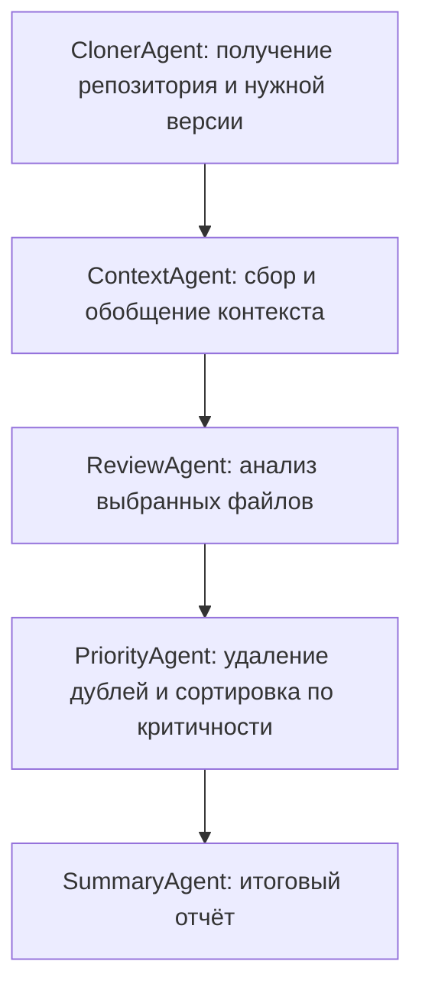

## Суть концепции

В RepoReviewer ревью публичного репозитория или PR организовано как последовательность стадий под управлением LangGraph:

Контекст включает структуру репозитория, README и превью ключевых файлов. Замечания содержат файл, строку, критичность, описание проблемы, предложение и фрагмент кода; результаты сохраняются в JSON и Markdown.

LLM используется для обобщения контекста, ревью и итогового отчёта. Получение репозитория выполняется программно, а приоритизация в основном детерминирована. Процесс запускается локально и обращается к внешним LLM-провайдерам через LiteLLM.

В статье показаны демонстрационные запуски; сравнительная оценка качества с человеческой разметкой запланирована на будущее.

## Связь и контекст
- **Источник:** [[RepoReviewer A Local-First Multi-Agent Architecture for Repository-Level Code Review]], §3–4, с. 2–4 PDF; §5.3 и §6, с. 5 PDF. Схема автора — Figure 1, [[RepoReviewer.pdf#page=2]].
- **Связь с существующими идеями:** [[Два уровня оркестрации ревью]] — пример организации анализа и обработки находок.
- **Противоречит / Альтернатива:**

## Мои мысли
Архитектурный пример, который можно как-то использовать частично со своими доработками.