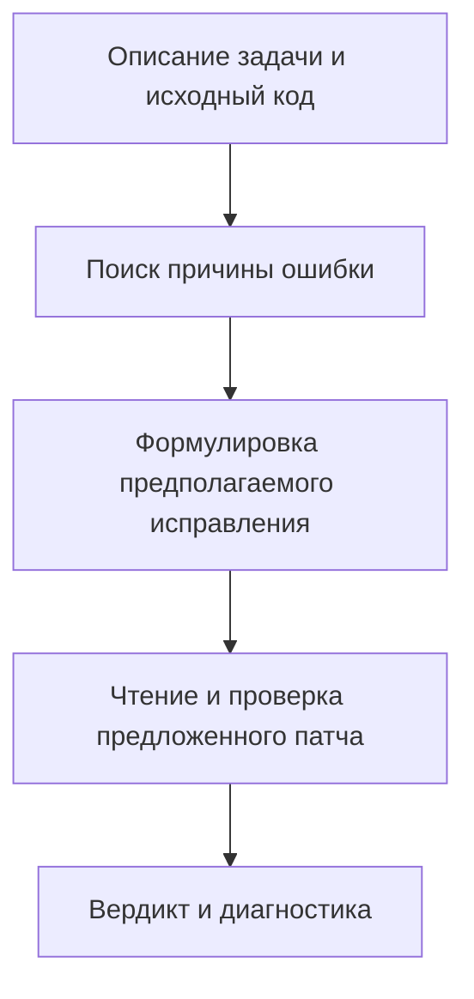

## Суть концепции

В промпте SWE-Review ревьюер сначала независимо разбирает исходную проблему и формулирует предполагаемое исправление. После этого он читает предложенный патч и проверяет его.

Это последовательность работы одного ревьюера. При проверке патча инструкция включает воспроизведение ошибки, проверку ожидаемого результата и регрессий. Схема передаёт порядок основных этапов; полный промпт приведён в приложении статьи.

Отдельно эффект такого порядка авторы не измеряли: его рассматривают как часть всего агентского процесса.

## Связь и контекст
- **Источник:** [[SWE-Review Closing the Loop on Issue Resolution with Agentic Code Review]], §4.1, с. 6 PDF; приложение E.2, с. 26–28 PDF.
- **Связь с существующими идеями:** [[Контекст ревью можно уточнять в ходе анализа]] — поиск причины ошибки требует исследования репозитория.
- [[Пример архитектуры мультиагентного ревью в RepoReviewer]] — другой пример организации процесса ревью.
- **Противоречит / Альтернатива:**

## Мои мысли

Можно рассмотреть как архитектурный вариант нашей системы: сначала сформировать независимое объяснение проблемы, затем оценить предложенное изменение. Гипотеза — такой порядок может уменьшить влияние чужого решения на анализ.
