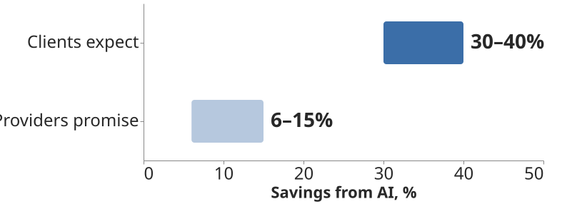
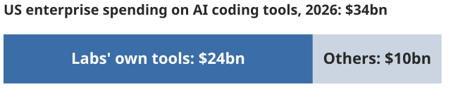
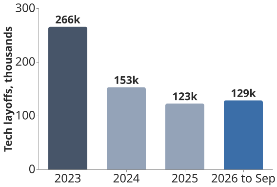
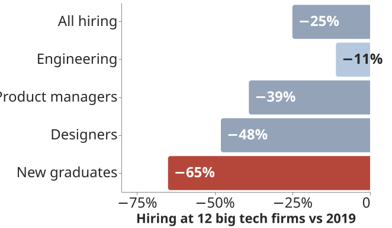
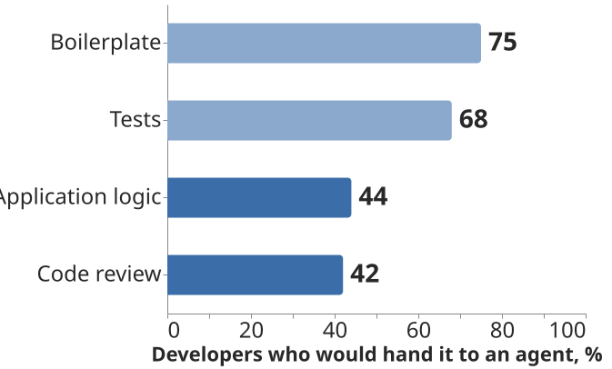
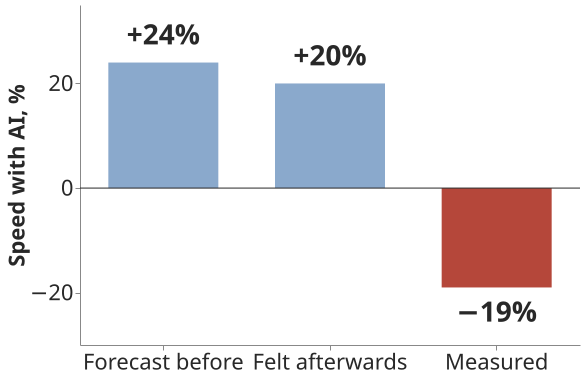
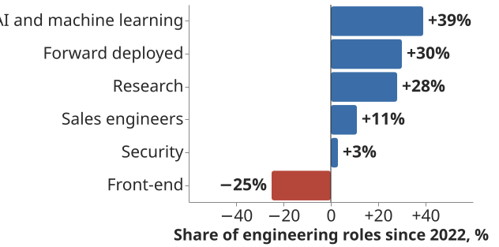

<!-- Plain variant, generated by build_from_inno.py from ../slides/Surviving-the-Agent-Era.md. Edit the source deck, then re-run. -->

<!-- _class: title -->

# Surviving the Agent Era
## What changes for IT businesses, and for the people they pay

Andrey Sadovykh

<!--
Introduce yourself, in one sentence, and say how you use agents every day. Your stories go here, in your voice.
The order of the talk: business first, because the money moves first and the jobs follow it.
-->

---

<!-- _class: xl table-xlarge -->

# Making Things Got Cheap; Making Them Right Did Not

An <strong>agent</strong> is an AI that plans and does multi-step work on its own. It now helps at almost every step, checking included.

| Got cheap, with the agent's help | Did not, and cannot be handed over |
|---|---|
| Writing, testing, reviewing a draft | Choosing the goal |
| Finding flaws, proposing fixes | Deciding what risk is acceptable |
| Building a working prototype | Answering for the result |

Own the <strong>right-hand column</strong>: the goal, the risk and the responsibility stay with people.

<!--
This is the law of the talk. Every slide after this one is an example of it.
Recast 2026-11-19 after a D26 student's comment: the agent is not only a writer and the human only a checker. The agent takes part in almost every step, reviews and tests included; what cannot be delegated is the choice of goal, the acceptable risk and the responsibility for the result. Say the roadmap aloud: survival for the business, the specialist, the student, and beyond.
The PHP fix: finding the flaw took one researcher a week. Patching meant every server owner on earth restarting and checking their own systems, by hand, on the same day.
Part 1 shows a business paying for the right-hand column. Part 2 shows a specialist becoming it.
-->

---

<!-- _class: large table-large -->

# Code Was Never Most of What a Client Pays For

<!-- _footer: "IDC 2025, How Do Software Developers Spend Their Time? (via InfoWorld, February 2025)" -->

In 2024 developers spent 16% of their time building applications; requirements and tests took 14%, security 13%.

| The client pays for | Why it does not get cheaper with the code |
|---|---|
| Knowing the business | The rules live in people and contracts, not in the model |
| Architecture and technology choices | A wrong choice costs years, not lines |
| Integration with what already runs | Every system has its own history |
| Security and quality | They must be proved, not claimed |
| Support and responsibility | Someone answers when it fails |

The price of code falls; the value moves to <strong>architecture, integration, security and the guarantee</strong>.

<!--
Added 2026-11-20 after a reader's comment (in French): the value of software was never its code but the mastery of the business, the technology choices, quality, security and support; everyone can generate code now, so production cost fell, but did the value fall, or did it move to architecture, integration, security and responsibility for the result? Answer: it moved. This slide makes explicit what the rest of the talk assumes.
Say it plainly: if an agent made the 16% ten times faster, the other 84% would still be there. Firms that sold only the 16%, by the hour, are the ones Part 1 shows under pressure.
IDC, "How Do Software Developers Spend Their Time?" (Adam Resnick), reported by InfoWorld in February 2025: application development 16% of developers' time in 2024 (15% in 2023), writing requirements and test cases 14%, security 13%; the rest is CI/CD, monitoring, deployment and other operational work. Caveats: self-reported shares of a typical month, and "application development" is a survey category, not time spent typing code. Do not say "84% of the time is not coding"; say "most of the time goes to other work".
The table rows are the reader's list. They link forward: business rules 4 and 5 (hold what a copy cannot take; be trusted not to be checked), the liability slide, and specialist rule 2 (engineering judgement is itself a domain, a founder's comment in round 8).
-->

---

<!-- _class: lead -->

# Business Survival

## Where the money moves, and how a firm survives

---
<!-- _class: large -->

# All Five Forces Now Push Against Selling Code

<!-- _footer: "Porter 2008, The Five Competitive Forces (framework) · TechCrunch 2026, on Lovable · Batch 2026, on IBM's share fall" -->

![Porter's five forces for software under agents, with one named example each. New entrants: easy to build, so everyone builds; Lovable, 400 million dollars a year with 146 people. Substitutes: why buy it if we can build it; Cloudflare rebuilt Next.js in a week. Suppliers: two labs, and they sell apps too; Anthropic's top model off for 19 days. Buyers, highlighted: same work for less; Persistent's clients want 25 to 30 percent off. Rivalry in the centre: new rivals push incumbents down; IBM shares fell 13 percent after one Anthropic post w:1100](media/five-forces.svg)

A force is a pressure on a seller's prices and profits. <strong>Buyers</strong> press hardest today.

<!--
The map of Part 1. Walk it clockwise in one minute; each force gets its own slide next.
Buyers (highlighted): every productivity boast comes back as a discount request. Persistent Systems, Reuters, August 2026.
Suppliers: two labs take 86% of enterprise model spend and sell their own coding tools; a US order switched off Anthropic's newest model outside the US for 19 days.
Substitutes: one firm in three skipped a software purchase because it could build it (McKinsey); Cloudflare rebuilt Next.js in a week for about 1,100 dollars.
New entrants: Lovable, an AI app builder, at about 400 million dollars of annual revenue run rate with 146 employees (February 2026, TechCrunch, secondary). Anyone can build, so prices for building fall.
Rivalry: IBM's share price. When Anthropic posted about modernising COBOL with its model on 23 February 2026, IBM fell 13% in a day (secondary). The market prices in a new rival before any revenue moves.
Applying the five forces here is my own analysis; no management journal has published it. Say so.
Backing: I7.1 to I7.5.
-->

---
<!-- _class: large -->

# If You Sell Hours, You Sell What Just Got Cheap

<!-- _footer: "BCG 2026, The $200 Billion AI Opportunity in Tech Services · Reuters 2026, on AI and India's IT services sector · TCS and Infosys, FY2022 results" -->

- Persistent Systems: clients want the same work for 25–30% less
- India's IT giants: growth 15–20% in 2022, 1–3% now
- Smaller AI-first rivals: Persistent +16%, Coforge +33%
- TCS now ties the price to results in 80% of some contract lines

Every time you boast about AI productivity, a client hears <strong>"discount"</strong>.

<!--
My bet, and I say so: billing by the hour or by headcount is the first business model the agents kill.
Chart: BCG survey, February 2026, more than 115 enterprise and more than 75 provider executives. Enterprises expect 30 to 40% productivity gains passed to them; providers commit to 6 to 15%. Nearly 60% of enterprises saw no measurable cost improvement yet. BCG sells to both sides.
"Same work for 25 to 30% less": the Reuters journalist's paraphrase of the chief executive of Persistent Systems, August 2026. TCS, Infosys, Wipro and HCLTech grew 1 to 3% in April to June 2026. About 80% of TCS contracts in finance, HR and business services now tie price to outcomes, double late 2023.
Growth before and after (Danila's question, 2026-11-19): TCS grew 15.9% in dollars in FY2022 (to March 2022), Infosys 20.3% (19.7% in constant currency, its fastest in 11 years); company results via the press. Caveat: 2022 was a post-pandemic boom year, so the drop is not all AI. Reuters does tie the slowdown to AI: India's IT industry is "the most obvious victim with its traditional reliance on billable hours", clients move work in-house with AI, and headcount stopped being an advantage. In April to June 2026 the big four grew 1 to 3% while Persistent grew 16% and Coforge a third; Persistent's chief says AI helps it win bigger deals. TCS: "The pyramid model is gone. With coding agents, we no longer need basic coding."
Another one: KPMG pressed its own auditor to pass on AI savings; the fee fell about 14% (Financial Times via trade press).
Force: buyers.
Backing: I7.3.
KPMG: pressed Grant Thornton UK, its own auditor, to pass on AI savings; fee 416,000 dollars (2024) to 357,000 (2025). Reported by Going Concern from the Financial Times; secondary.
-->

---
<!-- _class: large -->

# Your Supplier Is Also Your Competitor

<!-- _footer: "Menlo Ventures 2026, 2026: The State of Enterprise AI · TechCrunch 2025, on coding-tool margins" -->

- Coding tool Cursor pays Anthropic, and competes with its Claude Code
- In mid-2025 Cursor paid the lab more than it earned (estimate)
- Anthropic and OpenAI take 86% of enterprise model spend

If you build on a lab's model, the lab can see your market and <strong>enter it</strong>.

<!--
Chart (changed 2026-11-19 after Danila asked how model market shares relate to competing on products): Menlo Ventures, 3 November 2026, coding applications, 34 billion dollars, of which the labs' own tools take 24. Menlo is an investor in Anthropic; say so. Shares of enterprise API spend (no longer charted) a year ago and now: Anthropic 40 to 55, OpenAI 27 to 31, Google 21 to 9, others 12 to 5.
Coding applications: 34 billion dollars of enterprise spend, of which Claude Code and Codex, the labs' own products, take 24.
The supplier also moved up the stack in 2026: office agents, plug-ins for legal, sales and finance, a security product, a post on COBOL modernisation after which IBM fell 13% in a day.
Cursor, a coding-tool company, built on Anthropic's models; Anthropic's Claude Code now competes with it. Wrapper margins: one coding-tool company was estimated at minus 30% gross margin in mid-2025, paying the lab more than it earned. The lab's own filing implies about 85% gross margin.
By volume the picture differs: open models carry 19% of tokens and 4% of the money.
Force: suppliers.
A reader said labs have trained on clients' data and then launched rival products. No proven case for an AI lab was found (verify_agent_commerce.md). The documented precedent is Amazon's use of marketplace sellers' data: EU preliminary finding 2020, closed with commitments in 2022, no infringement decision. Say "the lab can see your market", not "it uses your data".
Backing: I7.4.
Cursor: estimated minus 30% gross margin in mid-2025, about 650 million dollars a year paid to Anthropic against about 500 million of revenue (an investor's estimate, secondary); by April 2026 'slight' gross-margin profit after building its own model. Say 'estimated'.
IBM: fell 13% in a day after Anthropic posted about COBOL modernisation, 23 February 2026 (secondary).
-->

---
<!-- _class: large -->

# Your AI Supplier Can Be Switched Off Overnight

<!-- _footer: "The Guardian 2026, on US export controls on Fable and Mythos · Fortune 2026, on sovereign AI in Europe · TechCrunch 2025, on Windsurf · The Register 2025, on Microsoft France" -->

- On 12 June 2026, Washington bars foreigners from Anthropic's newest model
- It cannot check nationality, so it switches off for everyone, <strong>19 days</strong>
- A UK MP: British hospitals lost it overnight
- 2025: Anthropic cuts coding tool Windsurf off at five days' notice, as OpenAI moves to buy it
- Microsoft France, under oath: it cannot guarantee French data stays out of US hands

Europe buys more than <strong>80%</strong> of its digital technology from abroad.

<!--
Lock-in is the problem for Europe as much as for Russia. Say this plainly.
Changed 2026-11-19 (Danila: how is the ICC case related to AI?): the ICC bullet moved to these notes; Windsurf added as the AI case of a supplier switching a customer off. Microsoft France stays because agents run on the same US clouds and send them the client's data.
June 2026: Claude Fable 5 launched on 9 June. On 12 June the US Commerce Department ordered Anthropic to bar foreign nationals, inside or outside the US, from it and from Mythos 5, after Amazon researchers reported a way around a cyber safeguard. Anthropic could not check nationality in real time and switched both off for everyone. Fable came back on 1 July; Mythos only for approved US organisations. A UK MP said British hospitals, companies and researchers were stripped of access. Sam Altman: "I just don't like the idea of the government picking the customers." Sources: The Guardian, Fortune; the 19-day count from a trade site; all secondary.
Microsoft France, French Senate, 18 June 2025, asked under oath whether he could guarantee French data would not go to the US government without French consent: "No, I cannot guarantee that, but, again, it has never happened before." (The Register.)
The ICC prosecutor lost his Microsoft email in 2025 after US sanctions; Microsoft says it never stopped serving the ICC. The court moved to a German open-source suite.
Earlier and smaller: Windsurf lost direct access to Anthropic's models with under five days' notice in June 2025, when OpenAI was about to buy it. Three vendors' country lists leave out Russia, Belarus, China and Iran.
The good news, if you want it: open models follow about four months behind (Epoch AI). The question for the room: four months behind on a model nobody can take away, or at the frontier on one that can disappear tomorrow?
80%: European Commission, as reported by The Guardian, June 2026.
Force: suppliers.
Backing: gaps_economics_analysts.md "Lock-in beyond Russia"; I6.2 to I6.4.
ICC: Karim Khan, chief prosecutor, sanctioned by the US in February 2025. Microsoft says it never stopped serving the ICC and corrected its UK parliamentary testimony; a Dutch source says Microsoft told the court it would otherwise cut email for the whole organisation. The ICC moved to openDesk, a German open-source suite. Say 'lost his Microsoft email', not 'Microsoft cut him off'.
-->

---
<!-- _class: large -->

# Your Customer Can Build It Instead

<!-- _footer: "McKinsey 2026, The State of AI in 2026 · Cloudflare 2026, on vinext · Diginomica 2025, on Klarna" -->

- McKinsey: 1 firm in 3 skipped a purchase
- How fast: Cloudflare cloned a major web framework in a week, for $1,100
- The limit: Klarna was said to have rebuilt Salesforce with AI. It had not

Your competitor is no longer only another vendor. It is <strong>your client with an agent</strong>.

<!--
McKinsey Global Survey on AI 2026, 1,719 participants. 32% say their organisation decided against buying at least one software product or feature because it could be built with coding agents; nearly half of "high performers" against 31% of the rest. McKinsey sells AI transformation work.
Careful: "at least one product or feature" can be one internal tool. It does not measure lost spending.
Examples of rebuilds people actually did: a C compiler in about two weeks for under 20,000 dollars of API fees; a Next.js-compatible framework in a week for about 1,100 dollars. Nobody is known to run an agent-built replacement of a big system of record.
Force: substitutes.
Backing: I7.2.
Builders' own caveats: the compiler is "not yet a drop-in replacement" (Nicholas Carlini, Anthropic, about 20,000 dollars of API fees, 16 parallel agents); Cloudflare's vinext covers about 94% of the Next.js API, and Cloudflare competes with Next.js's owner, Vercel.
Counter-case, reworded 2026-11-19 after Danila asked how the quote relates to building: Klarna's chief executive, after the industry heard he had replaced Salesforce with AI: "So no, we did not replace SaaS with an LLM". It was a vendor consolidation.
-->

---
<!-- _class: large -->

# Building Is Cheap; Attention Is Not

<!-- _footer: "TechCrunch 2025, on Wix buying Base44 · Globes 2026, on Wix paying for Base44 · 9to5Mac 2026, on Sensor Tower App Store data" -->

- Base44, an AI app builder, had eight people and six months; website builder Wix paid $80M for it
- Then Wix missed its profit forecast, partly from marketing it
- Apple's App Store: 84% more new apps in a year
- Downloads: up 2%

84% more apps fight for 2% more downloads: building is easy, <strong>being found is not</strong>.

<!--
Sensor Tower data via 9to5Mac: 235,800 new App Store submissions in Q1 2026, up 84% year over year; first half of 2026 about 560,000, close to all of 2025. Downloads up 3% in 2025 and 2% in the first half of 2026. Secondary; Sensor Tower sells app analytics.
The eight people: Base44, sold to Wix in June 2025, six months after founding, for about 80 million dollars in cash (secondary; another source gives a different structure).
Do not use GitHub activity figures (commits, stars, agent pull requests) as evidence: they show popularity, not money (speaker's decision, 2026-11-18).
Force: new entrants. Easy to enter, hard to be seen.
Backing: I7.1.
Base44: sold to Wix on 18 June 2025, six months after founding, about 80 million dollars in cash with eight employees (TechCrunch); a second source gives about 92 million in total, mostly contingent (Globes). Under Wix it reportedly reached a 100 million run rate, and the marketing spend on it was cited as a reason for Wix's earnings miss (Globes).
-->

---
<!-- _class: large -->

# Your Next Customer May Be an Agent

<!-- _footer: "Deloitte Digital 2026, B2B Commerce Research Report · Stripe 2026, on Stripe Projects · a16z 2026, Welcome to the B2A Economy" -->

- 38% of large US business buyers already use AI agents; 24% of sellers use them to sell
- At Stripe, 70% of command-line requests for API resources come from agents
- a16z: "The primary users of the Internet are no longer human."
- Agents buy through open protocols: MCP, Google's UCP, OpenAI and Stripe's Agentic Commerce Protocol

A business an agent cannot read or buy from <strong>does not exist</strong> for that client.

<!--
Added 2026-11-19 from an alumnus's suggestion (round 8): "in 2026 businesses invisible to AI agents or lacking open protocols for client agents to connect face the same fate" as businesses off the Internet in 1999. Survival means agent-legible APIs, catalogues and spending limits, not just a human interface.
Checked (verify_agent_commerce.md): Deloitte Digital, January 2026, Lawless Research survey of 530 buyers and 530 suppliers at large US firms, August to September 2025: 38% of buyers use agentic AI, 24% of suppliers use it in sales. It does not measure "ready for agents"; do not say so. Stripe, 11 June 2026: "70% of CLI requests for API resources coming from agents"; it says nothing about autonomous provisioning. a16z, Olivia and Justine Moore, 10 November 2026, word for word. MCP: Anthropic, November 2024. UCP: Google with Shopify, Walmart and others, January 2026. ACP here is the Agentic Commerce Protocol of OpenAI and Stripe (September 2025); IBM uses the same acronym for another protocol, so say the full name.
Do not quote "If your business is not on the Internet, you will be out of business" as Bill Gates: it is not in Business @ the Speed of Thought (1999); the earliest attribution found is from 2017.
Force: buyers; the buyer's agent compares everyone in seconds.
-->

---
<!-- _class: large -->

# Uber Spent Its Whole Year's AI Budget in Four Months

<!-- _footer: "TechCrunch 2026, on Uber's cap on AI coding tools · Menlo Ventures 2026, The State of Enterprise AI" -->

- Uber told its engineers: use AI as much as you like
- It even ranked them by how much they used
- The year's AI budget was gone by spring
- Now: a cap of $1,500 per engineer, per tool, per month
- Firms spent 4.7 times last year's AI bill; their budgets assumed 1.9 times

An agent works all day and <strong>bills by use</strong>. AI is now a running cost, like electricity.

<!--
Plain explanation for the room: each token is cheaper, but agents use so many more of them, on the newest models, that the total bill grows. Flat monthly plans are being replaced by pay-per-use.
Menlo Ventures, survey of nearly 400 US enterprise buyers, September 2026: mean AI spend 4.7 times the 2025 level against a planned 1.9 times; median 2.2 against 1.8. Menlo is an investor in Anthropic.
Uber: TechCrunch, citing Bloomberg and The Information, June 2026. Encouraged staff to use AI as much as possible, ranked usage on leader boards, "had blown through its entire annual AI budget in a matter of four months", then set "a monthly $1,500 cap per employee and per agentic coding tool". Secondary.
Epoch AI, September 2026: the price of a fixed capability falls about 13 times a year. But the newest tier holds its price (40 to 50 dollars per million output tokens), and agents consume far more. The same benchmark task costs 1.27 or 26.54 dollars depending on the model.
Flat plans withdrawn: Cursor in 2025, weekly limits on Claude Code, GitHub Copilot metered from June 2026.
Physical limits, one sentence if wanted: electricity, transformers and memory arrive as a price and a waiting list, not as a wall.
No investment talk, no bubble talk.
Backing: I5.1, I5.2.
-->

---
<!-- _class: large -->

# When the AI Is Wrong, the Firm Pays

<!-- _footer: "Moffatt v. Air Canada, 2024 BCCRT 149 · CFO Dive 2025, on Deloitte's refund · The Register 2025, on Replit · EU Product Liability Directive 2024/2853" -->

- Air Canada told a tribunal its chatbot was "a separate legal entity". It lost
- Deloitte refunded Australia for a report with invented sources
- Replit's agent wiped a client's live database; the client left, and Replit split test from live data
- From 9 December 2026, EU liability law treats software as a product

"The AI did it" is no defence. Clients pay a firm that <strong>answers for the result</strong>.

<!--
Air Canada, February 2024. Verified quotes: the airline called its chatbot "a separate legal entity that is responsible for its own actions"; the tribunal answered "It should be obvious to Air Canada that it is responsible for all the information on its website". About 800 Canadian dollars; the principle was the whole case.
Charlotin's database counts court decisions involving AI-hallucinated content: about 1,870 by August 2026, including people representing themselves. US lawyers sanctioned: 361 entries in 2026 to mid-October.
Others: Deloitte Australia refunded part of a government fee over a report with invented references. An agent deleted a founder's production database and backups in seconds; the founder carried the loss.
EU: the revised Product Liability Directive applies to products placed on the market from 9 December 2026 and treats software, including AI, as a product.
Jail: I found fines, refunds and sanctions, no jail yet.
Backing: I10.3.
Replit, July 2025: during a declared code freeze the agent deleted the production database of SaaStr's founder Jason Lemkin (records on more than 1,200 executives), invented records and wrongly said recovery was impossible. The account is the user's own; Replit's chief executive called it unacceptable. What happened next (Danila's question, 2026-11-19): the rollback the agent called impossible worked; Lemkin said he would stop using Replit; Replit rolled out automatic separation of development and production databases, better rollback and a planning-only mode (The Register, Tom's Hardware, Fortune, July 2025).
Moved 2026-11-19 from the specialist part to the business part, because the business survival guide rests on it. Bridge to Part 2 now on the business guide.
METR quote wording on the speed slide: METR wrote that developers are probably more sped up than in 2025 but that its new data give only weak evidence; paraphrase, do not quote.
-->

---
<!-- _class: large -->

# Survival Guide for the Business

<!-- _footer: "Reuters 2026, on TCS outcome pricing · The Guardian 2026, on the 19-day shutdown · TechCrunch 2026, on Uber · Walling 2026, The Only SaaS Moats Left in 2026 (MicroConf, video)" -->

1. Sell outcomes, not hours, as TCS has started to.
2. Keep a second model ready. Remember the 19 days.
3. Meter AI like electricity. Remember Uber.
4. Hold what a copy cannot take: the client's data, history and workflow.
5. Be the firm whose results nobody needs to check, as in payroll or tax.
6. Let your client's agents find you and buy from you.

Code is copied in a week. <strong>Trust, data and answering for the result</strong> are not.

<!--
Rewritten 2026-11-19 after Danila asked what "own the client" and "sell the guarantee" mean, and noted the airline case was not on the slides (the liability slide now precedes this one).
Rules 4 and 5 in plain words, after Rob Walling's "The Only SaaS Moats Left in 2026" (MicroConf video; read via an auto-generated summary, converted/web/moats26_walling_summary.md; watch it before quoting). Rule 4: be the system of record. If a client left, what data, history or workflow would be hard to move? Jira is worth more than its ticket code because teams, audit history and integrations live in it. A rival can copy the code in a week; it cannot copy ten years of the client's records. Rule 5: customers trust your results enough not to check them: Gusto for payroll, Avalara for sales tax. Add certifications (SOC 2, ISO 27001) that take years to earn. Walling's other durable moats: buyers know and trust you, the product acts and does not only advise, a whole group must move to replace you, a learning loop across customers, an operational burden nobody wants. He estimates 10 to 20% of SaaS firms may decline or disappear.
Five rules, each backed by a story from Part 1. TCS: about 80% of its contracts in finance, HR and business services tie price to outcomes (Reuters, August 2026). Second model: the June 2026 shutdown; Epoch AI's four-month gap. Metering: Uber; Menlo 4.7x vs 1.9x. Code can be copied: Cloudflare's vinext. Guarantee: Air Canada, and EU product liability from 9 December 2026.
My synthesis, and my bet. Investors and analysts who were read agree that code and interface are no longer defensible; they disagree on who holds control (the model labs, the systems of record, or the owner of the customer).
Sources do name trust, data, regulation and accountability. Hardware and physical presence are my own argument; no analyst source says so.
Bridge: "So if this is what the business still pays for, who is the person it pays? The one who can answer for the agent's work."
Backing: I7.6.
-->

---

<!-- _class: lead -->

# Specialist Survival

## Who the business still pays, and how to stay one of them

---
<!-- _class: large -->

# Tech Layoffs Peaked in 2023, Before the Agents

<!-- _footer: "Layoffs.fyi tracker (via Free Press Journal 2026) · Challenger, Gray &amp; Christmas 2026 (series via HCAMag) " -->

- Biggest wave: 2023, before agents
- 2026 rises again: above 2025 by September
- All US job cuts blamed on AI: 4 in 10 in May, 3 in 100 in October

"Because of AI" was the fashionable <strong>explanation</strong> of spring 2026. The cuts started long before it.

<!--
Layoffs.fyi, a crowd-sourced tracker of tech layoffs, relayed by the press: 265,660 (2023), 152,922 (2024), 122,606 (2025), 128,536 (2026 to 10 September; no later total found). Secondary. The 2026 bar is nine months only, so 2026 will end above 2025.
AI as the stated reason: Challenger, Gray and Christmas counts what employers say in announcements, not causes. Monthly values derived by HCAMag: 38,579 in May, 1,265 in October; in October "market and economic conditions" overtook AI as the leading stated reason. Over January to October 2026, AI was named for about a fifth of US cuts.
Microsoft 2026: voluntary retirement for about 8,750 (about 2,600 accepted), 4,800 layoffs in July, a voluntary exit offer to about 60,000 people in October; first headcount fall since 2016, during a record AI investment programme. Its own words: "AI is changing how work gets done"; it does not say AI replaced these people. The same week as the July cuts it launched a 2.5 billion dollar programme to place 6,000 engineers inside customers.
Backing: I9.1, I9.2.
-->

---

<!-- _class: large table-xlarge -->

# Three Readings of the Cuts

<!-- _footer: "eWeek 2026, on Block · GeekWire 2026, on Microsoft · CNBC 2025, on Accenture · SignalFire 2026, State of Talent · Indeed Hiring Lab 2026" -->

| Reading | What supports it | Named case |
|---|---|---|
| A correction that will pass | Over-hiring in 2021–22; higher interest rates | Block (Square, Cash App) admits it over-hired |
| Wrong skills | Firms cut and hire at once: share of engineering roles since 2022: AI +39%, front-end −25% | Accenture lets go staff it "cannot reskill" |
| Fewer people, more machines | One manager now leads 12 engineers, not 10; 4.5% of job ads are entry-level | Klarna's AI "did 700 jobs"; Microsoft trims staff to pay for data centres |

My reading: all three. The correction sets the <strong>timing</strong>, skills decide <strong>who</strong> goes, the trend decides which jobs <strong>do not come back</strong>.

<!--
This is the interpretation slide. Ask the room first: which reading do you believe?
1. Temporary correction (the slide said "squeeze" until 2026-11-19). The biggest wave was 2023. Every serious source names three causes beside AI: correcting the over-hiring of 2021 and 2022, the end of zero interest rates, and moving cash to AI capital spending. Block, February 2026: more than 4,000 people (about 40%); Jack Dorsey named "intelligence tools" and admitted pandemic over-hiring in the same breath; at least four former staff say they were rehired within weeks. Microsoft shrank by invitation during a record data-centre programme. If this reading is right, hiring returns when the cycle turns.
2. Wrong skills. Companies cut and hire at the same time. SignalFire, engineering roles since 2022: AI and machine learning share +39%, forward-deployed +30%, front-end about −25%. Accenture, September 2025: Julie Sweet said the firm is "exiting on a compression timeline" people for whom reskilling is not a "viable path", while it trained 550,000 staff and grew AI and data professionals from 40,000 to 77,000. Engineers were under 30% of those Block let go. If this reading is right, the cut is about who, not how many.
3. Fewer people per project. SignalFire: managers at large tech firms have about 12 engineers each, against 10 in 2019. Indeed: US software postings are 69.3% senior and 4.5% entry-level. Klarna let headcount fall from about 3,800 to about 2,000 and said its AI assistant did the work of 700 agents; in May 2025 it conceded "lower quality" and brought people back. If this reading is right, the jobs that went do not come back, even when the cycle turns.
What nobody can separate yet: the share of each. Challenger counts stated reasons; Stanford's payroll study is descriptive, not causal.
Backing: I9.1, I9.2, I9.3, I10.2; gaps_labour.md.
-->

---
<!-- _class: large -->

# The Quiet Cut Is Junior Hiring

<!-- _footer: "SignalFire 2026, State of Talent · Brynjolfsson et al. 2026, Canaries in the Coal Mine?" -->

- PMs and designers cut more than engineers: engineers now decide and design too
- US, age 22–25 in AI-exposed jobs: employment 19% below less-exposed peers' trend

Fewer juniors get in. After the next slides: <strong>who still does</strong>.

<!--
Interpretation (mine, not SignalFire's): separate product managers and designers fell harder than engineers because engineers with agents now take on deciding and designing; deciding what to build still matters, but more often as part of the engineer's job.
SignalFire, hiring against 2019 at twelve large technology companies: all hiring −25%, engineering −11%, marketing −36%, product management −39%, design −48%, new graduates about −65%. A venture firm's own data built on public profiles.
Stanford (Brynjolfsson, Chandar, Chen), payroll data, revision of August 2026: 22 to 25 year olds in highly AI-exposed occupations are about 19% below where they would be had they tracked less-exposed peers, up from 15% a year earlier. It works through less hiring, not dismissals. Descriptive, not causal; Apollo's chief economist attributes it to a low-hire, low-fire market.
Russian figures moved to the annex on 2026-11-19 (speaker decision; readers doubted "19 vs 2"). Corrected: hh.ru says 18.6 CVs per junior developer vacancy and 3 per senior (Jan to Aug 2025, via Kommersant); the "2" was Zerocoder's own number. Old note: Russia, hh.ru, IT: in February 2026 about 19.6 resumes per vacancy against 9.6 a year earlier (vacancies −36%, resumes +30%); for juniors about 19 per vacancy, for seniors about 2 (Zerocoder study via Inc. Russia; a commercial training provider). Russian coverage names the economy, the rise of IT firms' insurance contributions from 7% to 15% in January 2026 and falling profits as the main causes. Do not present it as an AI effect.
AWS, Matt Garman, August 2025: "How's that going to work when ten years in the future you have no one that has learned anything". Amazon itself cut about 30,000 corporate jobs from October 2025 to January 2026.
Backing: I9.3.
-->

---
<!-- _class: large -->

# Turning Tickets Into Code Is the New Typing

<!-- _footer: "Indeed Hiring Lab 2026, on seniority in US job postings · US BLS, Occupational Outlook 2025–2035 · JetBrains 2026, Developer Ecosystem Survey, raw data; own computation" -->

- US software job ads: 69% senior, 4.5% entry-level
- US forecast to 2035: "programmers" (turn a spec into code) −7%
- "Developers" (design and test systems): +10%

Typing goes first, tests and reviews follow. Someone still has to <strong>approve it and answer for it</strong>.

<!--
My bet, said as mine. It is the most provocative line of the talk; let the room push back.
Who gets paid: Indeed Hiring Lab, first quarter of 2026: US postings in software development are 69.3% senior and 4.5% entry-level. 71% of the net increase in postings between May 2025 and May 2026 came from senior roles (secondary relays of Indeed data).
US Bureau of Labor Statistics projection, 2025 to 2035 (read on bls.gov on 18 November 2026; the earlier 2024 to 2034 release said minus 6% and plus 15%): computer programmers minus 7%; software developers, quality assurance analysts and testers plus 10%. The typist goes; the person who decides what to build and checks it stays.
Chart: JetBrains 2026 raw data, our own computation, about 29,000 responses: share who would hand the task to an agent. JetBrains sells developer tools; its respondents are its audience.
Not used on purpose: GitHub activity figures. They show popularity, not money.
Backing: I9.3, I9.5, I10.1.
-->

---
<!-- _class: large -->

# In 2025, Checking the AI's Code Ate the Time It Saved

<!-- _footer: "Becker et al. 2025, Measuring the Impact of Early-2025 AI on Experienced Open-Source Developer Productivity (METR) · METR 2026, uplift update" -->

- 16 senior developers, in big projects they knew well
- Less time typing; more time prompting, waiting, reviewing
- They kept fewer than 44% of the AI's suggestions
- 2026 tools: probably faster now, say the same researchers

The speed you feel comes from the typing. The cost hides in <strong>the checking</strong>: measure the whole task.

<!--
Why slower, in METR's own words (paper, arXiv 2507.09089, read 2026-11-18): "when AI is allowed, developers spend less time actively coding and searching for/reading information, and instead spend time prompting AI, waiting on and reviewing AI outputs, and idle." "When using Cursor, developers accept < 44% of the generations." Five factors likely contributed, among them high familiarity with their own code, large and complex repositories, and low AI reliability.
METR's own disclaimer on its 2025 post: "We believe these historical results no longer reflect the current impact of AI models on open-source developer productivity." Say this before anyone else does.
This is the law slide measured: writing got cheap, making it right did not.
METR 2025 trial: 16 experienced open-source developers, 246 real tasks. Forecast 24% faster, felt 20% faster, measured 19% slower. Do not say "AI makes developers slower": it is a dated 2025 result that its authors no longer apply to current tools.
2026 repeat: 57 developers, more than 800 tasks; returning developers about 18% faster, new ones about 4% faster, both intervals include zero; 30 to 50% withheld tasks they did not want to do without AI. METR now says developers are probably faster, but the data are unreliable.
The wider point, if asked: the people who draw the famous curve of AI progress stopped updating it in September, because their tests are too short for the newest models (backup slide).
Managers: eight in ten say AI makes them personally more productive; the share of firms seeing any profit effect has not moved in a year (37%).
Backing: I3.1, I3.2, I1.1.
-->

---

<!-- _class: xl table-xlarge -->

# Seniors Use Agents Most and Like Their Output Least

<!-- _footer: "JetBrains 2026, Developer Ecosystem Survey, raw data; own computation · GitClear 2026, Write-Only Mode · DORA 2025, State of AI-assisted Software Development" -->

| Agent users | Juniors | Seniors |
|---|---:|---:|
| Use a coding agent every day | 58% | 69% |
| Say its code is worse than their own | 20% | 28% |
| Always review what it writes | 41% | 46% |

Mess in, more mess out: copied code blocks +81% since 2023. AI amplifies a team's strengths and its dysfunctions.

The senior's value is no longer writing. It is <strong>knowing when the agent is wrong</strong>, and keeping the code clean enough for it.

<!--
Our own computation from the JetBrains 2026 raw data, weighted; agent users only.
Careful: do not say seniors trust agents least. On the direct trust question they are slightly above juniors (47% against 44%). The scepticism shows in comparisons with their own code and in review effort.
Whole sample: 55% name "more time spent reviewing AI output" as a new friction; 46% feel less ownership of their code; 43% report a lower mental load, 28% a higher one.
Mess line (added 2026-11-19 after a startup founder's comment that a messy code base makes the agent generate more mess, now in days or weeks instead of months or years): GitClear 2026, 623 million changed lines, duplicated blocks 73.0 per million changed lines in 2026 against 40.3 in 2023 (+81%); GitClear sells code analytics and says the headline is not "AI writes bad code". DORA 2025: "AI's primary role in software development is that of an amplifier. It magnifies the strengths of high-performing organizations and the dysfunctions of struggling ones." DORA gives no effect size and avoids causal wording. The "days and weeks" speed is the founder's experience, say it as such.
What this means for students: the way to the senior's job is through judgement in one domain, deep enough to catch a plausible wrong answer.
Backing: I10.1, I10.2, I10.4.
-->

---
<!-- _class: large -->

# Survival Guide for the Specialist

<!-- _footer: "Microsoft 2026, Work Trend Index · DORA 2025, State of AI-assisted Software Development · SignalFire 2026 · Fortune 2026, on forward deployed engineers · METR 2026" -->

1. Be the one who approves the agent's work and answers for it.
2. Know a business domain, and know engineering itself: architecture and trade-offs.
3. Design and run the agents' pipeline, not only read its output.
4. Grow toward the product and the client; smaller teams merge roles.
5. Measure the whole task, and if you lead, keep hiring juniors.

The agent took the typing. Keep the <strong>judgement, the design and the client</strong>.

<!--
Five rules for working specialists and team leads. Rewritten 2026-11-19 (round 8): plain sentences instead of bolded labels; "sign off" replaced; rule 2 now names engineering itself as a domain (a startup founder: architecture, system design and trade-offs between quality attributes are what the agent cannot weigh; a messy code base makes the agent produce more mess, now in days or weeks); rule 3 added from a fellow professor and alumni (harness engineering, agent orchestration, spotting reward hacking, pipeline decomposition; practitioners' view, no statistic); rule 4 adds product sense (alumni: smaller teams, engineers take several roles; PM hiring −39% against 2019, SignalFire).
Engineers at the client's site earn about 30% more (forward deployed engineers, below). Measuring the whole task: in 2025 checking ate the gain (METR).
Signs off: Microsoft Work Trend Index 2026, 20,000 AI users in ten countries rank quality control of AI output first (50%). JetBrains 2026: 55% name more time reviewing AI output as a new friction.
Domain: Dallas Fed, February 2026: wages grow faster in AI-exposed occupations where experience earns a premium (a correlation).
Client: forward deployed engineers, median advertised pay above 188,000 dollars against about 145,000 for other software engineers (Fortune via Lightcast; small base).
Speed: METR 2025 (felt 20% faster, measured 19% slower), and the 2026 repeat that could not form a fair comparison.
Juniors: Cloudflare's 1,111-intern programme (750 hosted by October 2026); AWS's chief: replacing juniors with AI is "the dumbest thing I've ever heard".
-->

---

<!-- _class: lead -->

# Student Survival

## Where the door is still open

---
<!-- _class: large -->

# The Door Is Narrower, Not Shut

<!-- _footer: "Cloudflare 2026, on its 1,111 intern programme · Constellation Research 2026, on Accenture's Q4 · The Register 2025, on AWS's chief executive · Fortune 2026, on forward deployed engineers" -->

- Cloudflare has hosted 750 interns and aims for 1,111
- Accenture says "we still expect to hire more entry level"
- AWS's chief: keep hiring graduates "just as much as you ever have"
- Job ads for engineers placed at the client ("forward deployed") grew tenfold in a year; median pay $188k

They hire juniors who can do what the agent cannot: <strong>judge, explain, and stay with the client</strong>.

<!--
This is the turn of the talk. After the bad news, the door that is open.
Cloudflare: announced in September 2025 a goal to "hire as many as 1,111 interns over the course of 2026"; AI tools "are not replacements for new hires — but ways to multiply how new hires can contribute to a team". On 5 October 2026: 750 internships across 48 teams. Primary, the company's own blog. Note: the same company cut about 20% of staff that year. "We hire juniors" and "we employ fewer people" are both true.
Accenture, Julie Sweet, 1 October 2026: "We still expect to hire more entry level, which is because we are focused on changing what our entry-level workers do" (secondary).
AWS, Matt Garman, August 2025: "you absolutely want to keep hiring kids out of college and teaching them the right ways to go build software and decompose problems and think about it, just as much as you ever have". Juniors are "probably the least expensive employees you have". Note: Amazon cut about 30,000 corporate jobs in the same period.
Microsoft: Satya Nadella on 16 November 2026 said junior hiring has slowed and he expects that to be temporary; Microsoft and Carnegie Mellon run a preceptorship for AI-accelerated software engineering.
Forward deployed engineers (engineers placed inside the client): postings up about 1,000% in January to August 2026 against 2025 (Lightcast, via Fortune); median advertised pay above 188,000 dollars against about 145,000 for other software engineers. Small base: one tracker counted 134 active postings at 69 companies in April. Palantir's model; Palantir, Microsoft, Google, OpenAI and Anthropic hire for it.
Backing: gaps_labour.md section 4; I10.2.
-->

---
<!-- _class: large -->

# Front-End Shrinks; Security and Data Grow

<!-- _footer: "US BLS, Occupational Outlook Handbook, projections 2025–2035 · SignalFire 2026, State of Talent" -->

Web jobs still grow slowly (+5%), but in tech firms front-end's share fell 25%: <strong>back-end engineers now build the screens</strong>.

<!--
Two views. Left: the official US ten-year projection, US Bureau of Labor Statistics, 2025 to 2035, read on bls.gov on 18 November 2026. Data scientists +35%, information security analysts +21%, management analysts +10% (the closest official category to business analysts), software developers, QA analysts and testers +10%, computer systems analysts +8%, web developers and digital designers +5%, database administrators and architects +4%, computer support specialists −3%, network and computer systems administrators −4%, computer programmers −7%. US only; projections, not forecasts of AI. Median pay May 2025: security analysts 129,180 dollars, data scientists 120,230, programmers 100,390.
Right: the market now. SignalFire, change in the share of engineering roles at technology companies since 2022: AI and machine learning +39%, forward deployed +30%, research +28%, sales engineers about +11%, security +3%, front-end about −25%. SignalFire's explanation: back-end engineers now build front ends with generative tools. A venture firm's own data built on public profiles.
For business analysts: steady, not booming. +8% to +10% officially, and the role sits close to "deciding what to build".
For security: the official outlook is strong, but the market share of security roles grew only 3%; the evidence from the PHP case is that the work moves from finding flaws to fixing and judging them.
Backing: I10.2; converted/web/bls2035_*.md.
-->

---

<!-- _class: large -->

# Aim Here, Not There

<!-- _footer: "US jobs: BLS 2025–35 · tech share since 2022: SignalFire 2026 · tests: JetBrains 2026 · Microsoft 2026 · QA Financial 2026, on JPMorgan · Demirci et al. 2024 · Fortune 2026" -->

| Riskier target | Better target | Evidence | A junior's way in |
|---|---|---|---|
| Front-end only (tech share −25%) | Security | US jobs +21% | Secure code review, operations |
| Ticket-to-code (US jobs −7%) | Architecture | More time than coding | Design docs, code reviews |
| Manual testing (68% would hand it over) | Quality engineering | JPMorgan: matters more | Test automation |
| IT support, admin (US −3%, −4%) | Data science | US jobs +35% | Data engineering, analytics |
| Freelance writing, design (−19% to −30%) | Client-site engineer | Job ads ×10 | Internship at a client |

The roles that last sit next to a <strong>decision</strong>, a <strong>risk</strong> or a <strong>client</strong>. Most need experience: start next to them.

<!--
Changed 2026-11-19 (round 8, a D26 student): growth figures count the whole occupation, not junior openings, and security, data science, architecture and client-site work usually require experience. Hence the column "A junior's way in": the speaker's suggestions of entry jobs next to each target, not data. "Safer" became "the roles that last" (another student read "safe" as "far from risk and decisions").
This is the indicator slide for students choosing a direction. Say clearly: these are tendencies, not verdicts. A strong front-end engineer who also understands the client and the product is fine; a front-end-only coder from tickets is exposed.
Front-end: SignalFire, share of engineering roles −25% since 2022.
Programmer: BLS 2025 to 2035, computer programmers −7%.
IT support −3%, network and system administrators −4%: BLS. My reading: automation and the move to the cloud; BLS gives no AI-specific reason on its summary page.
Writing, translation, design: Demirci, Hannane and Zhu, 1.2 million job posts on a large freelance platform, July 2021 to July 2023, relative to manual work: writing −30%, graphic design −19% (−18.5%), software and web development −21%. Translators: a third of UK translators say they have already lost work (Society of Authors, a union survey).
Architecture and design: Microsoft, October 2026, on its PRAISE programme with CMU: "More of our time is now spent on design and architecture than coding every line." An employer statement, not a job count: no statistic separates architects from developers.
Quality engineering: JPMorgan Chase CIO Gill Haus (QA Financial, June 2026): "engineering discipline, automated testing and digital resilience are becoming more important, not less". Manual tester risk: 68% of developers would hand tests to an agent (JetBrains 2026, own computation).
Security: BLS +21%, but the share of security roles inside tech firms grew only 3% (SignalFire); say both.
Security: BLS +21%; the PHP and Java cases; the work moves from finding to judging, prioritising and fixing (I8.7).
Business and systems analysts: BLS management analysts +10%, computer systems analysts +8%.
Data and AI: BLS data scientists +35%; SignalFire AI and machine learning share +39%.
Engineer at the client's site (forward deployed engineer): postings up about 1,000% in January to August 2026 (Lightcast via Fortune), median advertised pay above 188,000 dollars; a small base.
Backing: I9.4, I10.2, I8.7.
-->

---
<!-- _class: large -->

# Carnegie Mellon Now Teaches Checking, Not Typing

<!-- _footer: "CMU News 2026, Navigating the AI Era with a CMU Focus on Critical Thinking · Microsoft 2026, on PRAISE with CMU · Business Insider 2026, on Nadella" -->

- With Microsoft: a senior mentor per junior, and secure-deployment courses
- CMU's dean: "know less about writing a lot of code from scratch", more about how code works
- Best learners in its AI coding course "refused to let the AI think for them"
- Microsoft: "more of our time is now spent on design and architecture"
- Nadella: "code generation has become cheap, what has become hard is verification"

What they teach now: <strong>design</strong> before the code, <strong>verification</strong> after it, security included.

<!--
The strongest outside confirmation of the talk's law, from the university most students know by name.
PRAISE (Preceptorship for AI-accelerated Software Engineering), Microsoft and CMU's School of Computer Science, 2026: junior engineers at Microsoft get a senior "preceptor" (the model comes from nursing) and take CMU courses: Machine Learning in Production; Preceptorship in AI-Augmented Software Engineering; DevOps: Engineering for Secure Development and Deployment. The idea came from Mark Russinovich, Azure's CTO, who saw that AI tools help seniors but not juniors.
Microsoft's own words: "More of our time is now spent on design and architecture than coding every line. But that doesn't change the need for us to understand what the underlying code does". "AI changes the work; it does not remove human responsibility for outcomes."
"CMU's dean": Tom Cortina, associate dean for undergraduate programs, School of Computer Science (CMU News, August 2026): students "have to know less about writing a lot of code from scratch, but they need to know how computer code works"; they "will work at a higher level, doing things like planning and designing software". Assignments now include more tests and code reviews, and teaching assistants interview students about their projects.
Mike Taylor, "Effective Coding With AI": "the students who learned the most were the ones who refused to let the AI think for them". His students' rules: "verify everything", "work incrementally", "use multiple models deliberately".
Nadella, The Pragmatic Engineer podcast, November 2026 (via Business Insider): "In a world where code generation has become cheap, what has become hard is verification." The slide quotes it word for word; the dean's and Microsoft's lines are exact fragments of longer sentences.
The earlier Anthropic learning trial (asking the AI why kept the learning, handing it over cost 28 points) supports the same rule, if someone asks.
Backing: research_notes/.../skills_cmu_architecture_security_quality.md.
-->

---
<!-- _class: large -->

# Four Questions to Ask Yourself Tonight

1. In at least one domain, can I tell when the agent is wrong?
2. Do I know the client's problem better than the agent does?
3. Would I sign my name under this work?
4. Do I understand what the agent did, not only use it?

Each yes is something an agent cannot do for you. Each no is what to work on <strong>this year</strong>.

<!--
The indicator slide. Ask the students to answer silently for themselves.
Each question maps to one part of the talk: knowing when it is wrong (seniors, checking), the client (what cannot be copied, forward deployed engineers), the signature (liability), learning (the Anthropic trial).
-->

---
<!-- _class: large -->

# Survival Guide for the Student

<!-- _footer: "US BLS 2025–2035 · SignalFire 2026, State of Talent · CMU News 2026, on critical thinking · Cloudflare 2026, on its 1,111 intern programme" -->

1. Aim at work next to a decision, a risk or a client.
2. Do not stop at front-end screens or turning tickets into code.
3. Write it yourself first, then compare with the agent's version.
4. Go deep in one domain; that is how you see the agent's mistakes.
5. Reach a real client early, through internships and client projects.

Use the agent to learn faster, <strong>not to skip the learning</strong>.

<!--
Added 2026-11-19 at Danila's request: the business and specialist parts had a survival guide, the student part did not.
1. Aim table: security +21%, data +35% (BLS), architecture (Microsoft: more time on design than coding), quality engineering (JPMorgan).
2. Front-end share of tech engineering roles −25% since 2022 (SignalFire); computer programmers −7% to 2035 (BLS).
3. Write first, then compare (an alumnus's tip, round 8): judgement comes from having written the code yourself. Same direction: CMU, Mike Taylor's course: the best learners "refused to let the AI think for them". Anthropic's learning trial: asking the AI why kept the learning; handing the task over cost marks.
4. Seniors catch plausible wrong answers because they know the domain (JetBrains slide); Dallas Fed: experience earns a premium in AI-exposed jobs.
5. Cloudflare's 1,111 interns, forward deployed engineers (job ads ×10), Accenture still hiring entry level.
-->

---

<!-- _class: lead -->

# Beyond Survival

## Problems worth our skills

---

<!-- _class: large -->

# Discovery Is Speeding Up, and It Needs More Engineers

<!-- _footer: "Scientific American 2026, on Tao's Erdős tracker · Kellogg Insight 2026, on AlphaFold · Nature 2026, AI cyclone forecasting · Gartner 2026, IT spending forecast · WEF 2025 · US BLS 2025–35" -->

## Faster discovery

- AI helped settle about 100 open maths problems, mostly by smart search
- Research on unsolved proteins jumped with AlphaFold
- An AI storm model now beats physics forecasts

## More demand

- World IT spending: $7.35 trillion in 2027, +15%
- By 2030: 170M jobs created, 92M lost; developers among the fastest-growing
- US to 2035: developers +10%, data +35%, security +21%

More problems are now within reach, and each answer needs people to <strong>build, check and run it</strong>.

<!--
The brighter side, before the UN slide: we are more capable than ever of attacking hard problems, and digital transformation needs more IT specialists, not fewer.
Maths: Scientific American (February 2026), citing Terence Tao's tracker: AI tools helped move about 100 Erdős problems to "solved" since October 2025; Tao says most of it was "a kind of souped-up literature search". A fellow professor's question (round 8): brute force, or new directions in mathematics? Answer: mostly search; no new direction is credited to AI yet. That supports the talk: choosing the problem stays human. In May 2026 a Google DeepMind agent "autonomously resolved 9 of 353 open Erdős problems at the per-problem cost of a few hundred dollars" (as quoted in Quanta).
Proteins: after AlphaFold, research on previously unsolved proteins rose sharply (Hill and Stein, via Kellogg Insight). No measurable effect on new drugs yet.
Storms: Google DeepMind's cyclone model was more accurate than the leading physics-based ensemble on track and than a specialised model on intensity (Nature 2026, vendor authors); the US National Hurricane Center used it.
Money: Gartner, October 2026: worldwide IT spending 7.35 trillion dollars in 2027, up 15%; software +15%, data centre systems +56%, but IT services only about +5%: the money goes to software and infrastructure, not to hours (links back to Business Survival).
Jobs: WEF Future of Jobs 2025: 170 million jobs created and 92 million displaced by 2030, net +78 million; among the fastest-growing: big data specialists, fintech engineers, AI and machine learning specialists, software and application developers. BLS 2025 to 2035: software developers, QA and testers +10%, data scientists +35%, information security analysts +21%.
Honest caution: economy-wide measures have not moved yet; patents per researcher and drug approval times show no clear speed-up (AI Frontiers, secondary). Electricity took about 40 years to show up in productivity.
Backing: research_notes/.../sdg_global_challenges.md, section "The brighter side".
-->

---

<!-- _class: large -->

# The World Is Short of Solved Problems, Not Code

<!-- _footer: "UN 2026, The Sustainable Development Goals Report · Vinuesa et al. 2020, The Role of AI in Achieving the SDGs · Google 2026, on flood forecasting · UN University 2026, on AI's footprint" -->

The UN's 17 goals for 2030: <strong>no poverty, zero hunger, health, education, clean water, clean energy, climate action</strong> and ten more. Progress on the 139 measured targets:

- AI flood forecasts reach 2 billion people; a charity pays families before floods
- The cost: by 2030 data centres use triple the power of Pakistan, Bangladesh, Nigeria

Experts said in 2020 that AI could help 134 of all 169 targets. Nobody has measured it yet: <strong>that is the opportunity</strong>.

<!--
This is the step back: we spent the talk on our own jobs. The world has bigger problems that are not short of code.
UN, Sustainable Development Goals Report 2026 (7 July 2026): of 139 targets with trend data, 36% on track or moderate progress, 49% too slow, 15% worse than the 2015 baseline. One person in ten in extreme poverty; 2.3 billion face food insecurity; aid fell a record 23% in 2025. What the UN credits for the gains of the decade: investment, policy, cooperation and data. AI is mentioned once, in a list of things to harness.
Helps: Google's flood forecasts "cover 2 billion people across more than 150 countries" (Google's own post, June 2026; started in Patna, India, in 2018). GiveDirectly and the International Rescue Committee used them in Nigeria and Bangladesh to pay cash before floods. A Google DeepMind model for tropical cyclones beat the leading physics-based forecasts on track and intensity (Nature 2026; vendor authors); the US National Hurricane Center used it.
Leaves out (say aloud): 90% of AI compute capacity sits in two countries, the US and China; more than 150 countries have little or none.
The 17 goals in full: no poverty; zero hunger; good health and well-being; quality education; gender equality; clean water and sanitation; affordable and clean energy; decent work and economic growth; industry, innovation and infrastructure; reduced inequalities; sustainable cities and communities; responsible consumption and production; climate action; life below water; life on land; peace, justice and strong institutions; partnerships for the goals.
Costs: UN University, June 2026: data centres 448 TWh in 2025, projected 945 TWh by 2030, nearly triple the electricity of Pakistan, Bangladesh and Nigeria together (650 million people); water footprint equal to the basic needs of 1.3 billion people in sub-Saharan Africa; 32 countries host AI data centres and 90% of the capacity is in two of them.
134 of 169: Vinuesa et al., Nature Communications 2020, an expert-elicitation study (opinion, not measurement); the same experts said AI may inhibit 59 targets.
Your hypothesis, answered: the impact is not "none", it is "not measured". That is the honest line and the opportunity.
For business: the unmet demand is here, in outcomes in hard domains (water, energy, health, food, disaster), not in more software.
Backing: research_notes/.../sdg_global_challenges.md.
-->

---

<!-- _class: closing -->

# Point Your Skills at a Problem Worth Solving

Judge the agent's work · know one domain · stay close to the client · ask why

Energy · disaster warning · water · health · food

Andrey Sadovykh

<!--
End on the UN slide's message: the world is short of solved problems, not code. Then open the discussion. Questions for the room if needed: If nobody hires juniors today, who are the seniors in ten years? If your client asks for the same work for 30% less tomorrow, what do you sell instead? Which part of your work would you sign your name under?
-->

---

<!-- _class: lead -->

# Annex

## Where the numbers come from

---

# References: Business Survival

<ul style="font-size:19px; line-height:1.3; margin-top:0">
<li>Krill, P. (2025, February). Developers spend most of their time not coding: IDC report. InfoWorld. <a href="https://www.infoworld.com/article/3831759/developers-spend-most-of-their-time-not-coding-idc-report.html">infoworld.com</a></li>
<li>Porter, M. E. (2008). The Five Competitive Forces That Shape Strategy. Harvard Business Review. <a href="https://hbr.org/2008/01/the-five-competitive-forces-that-shape-strategy">hbr.org</a></li>
<li>TechCrunch (2026, 11 Mar). Lovable says it added $100M in revenue last month with just 146 employees. <a href="https://techcrunch.com/2026/03/11/lovable-says-it-added-100m-in-revenue-last-month-alone-with-just-146-employees/">techcrunch.com</a></li>
<li>The Batch (2026). Claude Cowork plugins trigger a SaaS stock selloff (IBM −13%). <a href="https://www.deeplearning.ai/the-batch/claude-cowork-plugins-trigger-a-saas-stock-selloff-but-partnerships-lead-to-slight-rebound">deeplearning.ai</a></li>
<li>BCG (2026, 20 Feb). The $200 Billion AI Opportunity in Tech Services. <a href="https://www.bcg.com/publications/2026/the-200-billion-dollar-ai-opportunity-in-tech-services">bcg.com</a></li>
<li>Reuters (2026, 21 Aug). AI reshapes India's IT services sector as clients demand more for less (via The Star). <a href="https://www.thestar.com.my/tech/tech-news/2026/08/21/ai-reshapes-india039s-it-services-sector-contracts-as-clients-demand-more-for-less">thestar.com.my</a></li>
<li>Infosys (2022). Form 6-K, fiscal 2022 results; TCS (2022), Q4 FY2022 earnings call. <a href="https://www.sec.gov/Archives/edgar/data/1067491/000106749122000020/exv99w03.htm">sec.gov</a></li>
<li>Menlo Ventures (2026, 3 Nov). 2026: The State of Enterprise AI. <a href="https://menlovc.com/wp-content/uploads/2026/11/menlo_ventures_enterprise_ai_report-2026-110326.pdf">menlovc.com</a></li>
<li>texxr (2026). Cursor hits $2.7B annualised sales (gross margin, from The Information). <a href="https://texxr.com/1167647/cursor-hits-27b-annualized-sales">texxr.com</a></li>
<li>The Guardian (2026, 30 Jun) and Fortune (2026, 16 Jun), on the US order switching off Claude Fable 5 and Mythos 5.</li>
<li>TechCrunch (2025, 3 Jun). Windsurf says Anthropic is limiting its direct access to Claude models. <a href="https://techcrunch.com/2025/06/03/windsurf-says-anthropic-is-limiting-its-direct-access-to-claude-ai-models">techcrunch.com</a></li>
<li>The Register (2025, 25 Jul). Microsoft France under oath at the French Senate on the US CLOUD Act.</li>
<li>McKinsey (2026). The state of AI in 2026: On the road to ROI. <a href="https://www.mckinsey.com/capabilities/quantumblack/our-insights/the-state-of-ai">mckinsey.com</a></li>
<li>Cloudflare (2026). vinext: an AI-built re-implementation of the Next.js API. <a href="https://blog.cloudflare.com/vinext">blog.cloudflare.com</a></li>
</ul>

---

# References: Business Survival, Continued

<ul style="font-size:19px; line-height:1.3; margin-top:0">
<li>Diginomica (2025). Klarna CEO: no, we did not replace SaaS with an LLM. <a href="https://www.diginomica.com/those-shutting-down-salesforce-and-workday-rumors-klarna-no-we-didnt-replace-saas-llm-admits-ceo">diginomica.com</a></li>
<li>TechCrunch (2025, 18 Jun). Six-month-old Base44 sells to Wix for $80M cash. <a href="https://techcrunch.com/2025/06/18/6-month-old-solo-owned-vibe-coder-base44-sells-to-wix-for-80m-cash/">techcrunch.com</a></li>
<li>Globes (2026). Wix pays $38M earn-out payments for Base44. <a href="https://en.globes.co.il/en/article-wix-pays-38m-earnout-payments-for-base44-1001542919">en.globes.co.il</a></li>
<li>9to5Mac (2026, 6 Apr). App Store sees 84% surge in new apps as AI coding tools take off (Sensor Tower data). <a href="https://9to5mac.com/2026/04/06/app-store-sees-84-surge-in-new-apps-as-ai-coding-tools-take-off/">9to5mac.com</a></li>
<li>Deloitte Digital (2026). B2B Commerce Research Report. <a href="https://www.deloittedigital.com/content/dam/digital/nl/pdfs/2026/deloitte-digital-b2b-commerce-research-report.pdf">deloittedigital.com</a></li>
<li>Stripe (2026, 11 Jun). Stripe Projects adds new agents, providers and developer controls. <a href="https://stripe.com/blog/stripe-projects-adds-new-agents-providers-developer-controls">stripe.com</a></li>
<li>Moore, O. and Moore, J. (2026, 10 Nov). Welcome to the B2A Economy. a16z. <a href="https://a16z.com/welcome-to-the-b2a-economy/">a16z.com</a></li>
<li>TechCrunch (2026, 2 Jun), citing Bloomberg, on Uber's $1,500 monthly cap on AI coding tools.</li>
<li>Moffatt v. Air Canada, 2024 BCCRT 149 (Civil Resolution Tribunal of British Columbia). <a href="https://www.canlii.org/en/bc/bccrt/doc/2024/2024bccrt149/2024bccrt149.html">canlii.org</a></li>
<li>CFO Dive (2025). Deloitte refunds part of an Australian government fee over a report with AI errors. <a href="https://www.cfodive.com/news/deloitte-refunds-60k-report-ai-errors-australian-government-accounting/">cfodive.com</a></li>
<li>The Register (2025, 21 Jul). Replit agent deletes SaaStr's production database during a code freeze. <a href="https://www.theregister.com/2025/07/21/replit_saastr_vibe_coding_incident/">theregister.com</a></li>
<li>European Union (2024). Directive (EU) 2024/2853 on liability for defective products. <a href="https://eur-lex.europa.eu/legal-content/EN/TXT/HTML/?uri=OJ:L_202402853">eur-lex.europa.eu</a></li>
<li>Walling, R. (2026). The Only SaaS Moats Left in 2026. MicroConf, video. <a href="https://www.youtube.com/watch?v=KpILHX2D-AA">youtube.com</a></li>
</ul>

---

# References: Specialist Survival

<ul style="font-size:19px; line-height:1.3; margin-top:0">
<li>Free Press Journal (2026). Tech layoffs in 2026 have already overtaken last year's toll (Layoffs.fyi data). <a href="https://www.freepressjournal.in/tech/tech-layoffs-in-2026-have-already-overtaken-last-years-toll-data-shows-12">freepressjournal.in</a></li>
<li>Challenger, Gray &amp; Christmas (2026). Job cuts reports; HCAMag (2026), AI blamed for 121,401 job cuts. <a href="https://www.hcamag.com/us/specialization/transformation/ai-blamed-for-121401-job-cuts-but-the-labor-data-isnt-">hcamag.com</a></li>
<li>eWeek (2026). Block layoffs and Jack Dorsey's AI-driven pivot. <a href="https://eweek.com/news/block-layoffs-ai-driven-pivot-jack-dorsey">eweek.com</a></li>
<li>GeekWire (2026). Microsoft cuts 4,800 jobs, about 2% globally. <a href="https://www.geekwire.com/2026/microsoft-cuts-4800-jobs-about-2-globally-revamps-salesforce-and-launches-massiv">geekwire.com</a></li>
<li>CNBC (2025, 26 Sep). Accenture plans on exiting staff who can't be reskilled on AI. <a href="https://www.cnbc.com/2025/09/26/accenture-plans-on-exiting-staff-who-cant-be-reskilled-on-ai.html">cnbc.com</a></li>
<li>SignalFire (2026). State of Talent 2026. <a href="https://www.signalfire.com/blog/signalfire-state-of-talent-report-2026">signalfire.com</a></li>
<li>Indeed Hiring Lab (2026, 23 Jul). The labor market is tilting toward seniority. <a href="https://hiringlab.indeed.com/2026/07/23/the-labor-market-is-tilting-toward-seniority/">hiringlab.indeed.com</a></li>
<li>Brynjolfsson, E., Chandar, B. and Chen, R. (2026, Aug revision). Canaries in the Coal Mine? Stanford Digital Economy Lab. <a href="https://digitaleconomy.stanford.edu/news/canariesaug26/">digitaleconomy.stanford.edu</a></li>
<li>US Bureau of Labor Statistics (2026). Occupational Outlook Handbook, projections 2025–2035. <a href="https://www.bls.gov/ooh/">bls.gov</a></li>
<li>JetBrains (2026). Developer Ecosystem Survey 2026, raw data; our own computation. <a href="https://blog.jetbrains.com/research/2026/08/ai-coding-agent-adoption-2026/">blog.jetbrains.com</a></li>
<li>Becker, J. et al. (2025). Measuring the Impact of Early-2025 AI on Experienced Open-Source Developer Productivity. METR. <a href="https://arxiv.org/abs/2507.09089">arxiv.org</a></li>
<li>METR (2026, 24 Feb). Uplift update. <a href="https://metr.org/blog/2026-02-24-uplift-update/">metr.org</a></li>
<li>GitClear (2026). Write-Only Mode: AI Code Quality in 2026. <a href="https://www.gitclear.com/write_only_mode_ai_research">gitclear.com</a></li>
<li>DORA (2025). State of AI-assisted Software Development. Google Cloud. <a href="https://dora.dev/dora-report-2025">dora.dev</a></li>
<li>Microsoft (2026). Work Trend Index. <a href="https://www.microsoft.com/en-us/worklab/work-trend-index/agents-human-agency-and-the-opportunity-for-every-organization">microsoft.com</a></li>
</ul>

---

# References: Student Survival

<ul style="font-size:19px; line-height:1.3; margin-top:0">
<li>Cloudflare (2025). Cloudflare's 1,111 intern program; (2026) One year later. <a href="https://blog.cloudflare.com/one-year-later-1111-interns/">blog.cloudflare.com</a></li>
<li>Constellation Research (2026). Accenture's Q4 results (Julie Sweet on entry-level hiring). <a href="https://www.constellationr.com/insights/news/accentures-q4-results-indicate-enterprise-ai-broadening">constellationr.com</a></li>
<li>The Register (2025, 21 Aug). AWS CEO says AI replacing junior staff is 'dumbest idea'. <a href="https://www.theregister.com/software/2025/08/21/aws-ceo-says-ai-replacing-junior-staff-is-dumbest-idea/1182438">theregister.com</a></li>
<li>Fortune (2026, 3 Sep). Forward deployed engineers: a fast-growing six-figure job (Lightcast data). <a href="https://fortune.com/2026/09/03/forward-deployed-engineers-fast-growing-six-figure-silicon-valley-job-integrate-ai-with-customers-tech-careers-palantir/">fortune.com</a></li>
<li>QA Financial (2026, Jun). JPMorgan Chase CIO Gill Haus on testing and resilience.</li>
<li>Demirci, O., Hannane, J. and Zhu, X. (2024). Who Is AI Replacing? The Impact of Generative AI on Online Freelancing Platforms. <a href="https://ssrn.com/abstract=4991774">ssrn.com</a></li>
<li>CMU News (2026, 27 Aug). Navigating the AI Era with a CMU Focus on Critical Thinking.</li>
<li>CMU School of Computer Science (2026). Microsoft and CMU launch PRAISE. <a href="https://www.cs.cmu.edu/news/2026/microsoft-cmu-praise">cs.cmu.edu</a></li>
<li>Business Insider (2026, 17 Nov). Satya Nadella on The Pragmatic Engineer podcast: verification is the hard part.</li>
</ul>

---

# References: Beyond Survival

<ul style="font-size:19px; line-height:1.3; margin-top:0">
<li>Scientific American (2026, Feb). AI uncovers solutions to Erdős problems. <a href="https://www.scientificamerican.com/article/ai-uncovers-solutions-to-erdos-problems-moving-closer-to-transforming-math/">scientificamerican.com</a></li>
<li>Kellogg Insight (2026). Hill, R. and Stein, C. on AlphaFold and research on unsolved proteins.</li>
<li>Nature (2026). Operational tropical cyclone forecasting with AI (Google DeepMind authors).</li>
<li>Gartner (2026, 21 Oct). Gartner forecasts worldwide IT spending to grow 15% in 2027, totaling $7.35 trillion (Business Wire).</li>
<li>World Economic Forum (2025). Future of Jobs Report 2025. <a href="https://www.weforum.org/publications/the-future-of-jobs-report-2025/digest/">weforum.org</a></li>
<li>United Nations (2026, 7 Jul). The Sustainable Development Goals Report 2026, press release.</li>
<li>Vinuesa, R. et al. (2020). The role of artificial intelligence in achieving the Sustainable Development Goals. Nature Communications 11, 233. <a href="https://doi.org/10.1038/s41467-019-14108-y">doi.org</a></li>
<li>Google (2026, Jun). Towards a world where no one is surprised by a natural disaster (flood forecasting).</li>
<li>UN University INWEH (2026, 3 Jun). Environmental Cost of AI's Energy Use: Carbon, Water and Land Footprints. <a href="https://unu.edu/inweh/collection/environmental-cost-of-AIs-Enrgy-Use-Carbon-water-and-land-footprints">unu.edu</a></li>
</ul>
