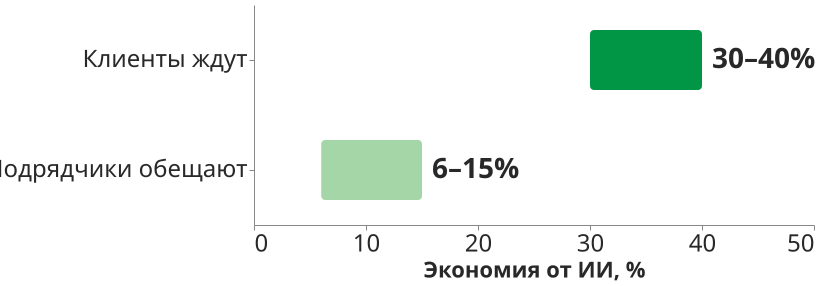
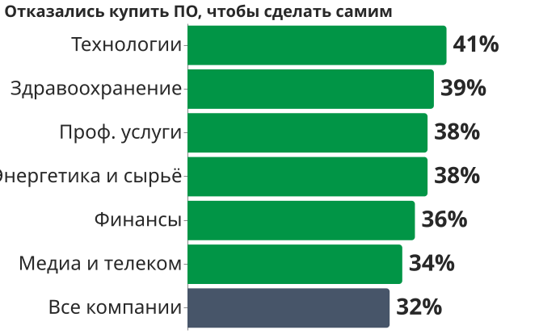
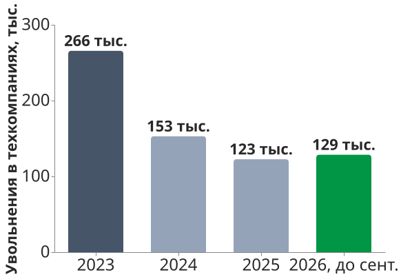
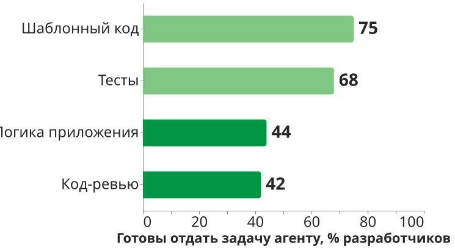
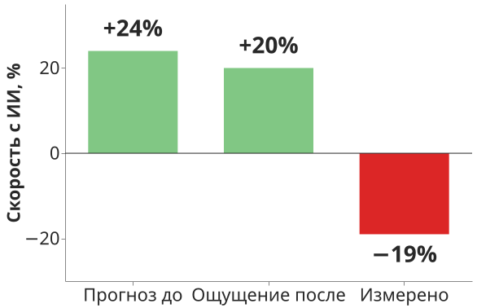
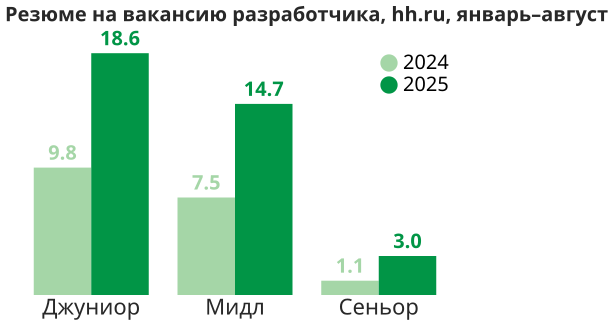

<!-- _class: title -->

# Выжить в эпоху агентов
## …и как в ней преуспеть

Андрей Садовых · Университет Иннополис

<!--
Russian version, 30 minutes, draft 4 (2026-11-20): same structure as ../slides/Surviving-the-Agent-Era.md (English): hook, law, value, then four parts, each a divider, an answer slide and one slide per force or area. Russian data integrated in the main slides. Speaker notes are copied from the English deck.
-->
<!--
Introduce yourself, in one sentence, and say how you use agents every day. Your stories go here, in your voice.
Draft 4 (2026-11-20), restructured after an industry peer said the talk had no single message and was scattered, and suggested "Thriving" for the title. The title keeps "Surviving" as the hook for an anxious room; the last part turns to thriving. His line for that turn: those who only try to survive end up overboard; better to try to thrive, and you will survive on the way.
The plan, said aloud in one breath: four headlines that scare people; which of them hold; what a firm, a specialist and a student can do about it; and why I like this era.
-->

---

<!-- _class: xl b8 -->

# Каких из этих новостей стоит бояться?

<!-- _footer: "CIO.com 2026, on Anthropic's COBOL claim and IBM · Reuters 2026, on India's IT services · Challenger, Gray &amp; Christmas 2026 (via HCAMag) · hh.ru via Kommersant, 11 Sep 2025" -->

- Акции IBM −13% за день: Anthropic заявила, что её ИИ мигрирует COBOL
- Persistent Systems: клиенты хотят ту же работу на 25–30% дешевле
- Challenger: в мае 2026-го 4 из 10 сокращений в США списали на ИИ
- hh.ru: на вакансию джуниора 18,6 резюме, на сеньора — 3

Одни подтверждаются, другие нет. Разберём, <strong>какие и что с этим делать</strong>.

<!--
The hook. Read the four headlines slowly and ask the room: which of these worries you? Hands up. Do not answer yet; each part of the talk answers one.
Verdicts, for the speaker (each one comes back later):
1. IBM −13%: holds for firms that sell code. On 23 February 2026 Anthropic posted that its model can quickly modernise, that is migrate and refactor, legacy COBOL, the mainframe code IBM's business rests on; IBM fell 13% in a day (CIO.com, secondary). IBM's answer (Rob Thomas): mainframe revenue was up 48%. Say the claim is Anthropic's, not a proven migration. The market priced in a new rival before any revenue moved. Answered in the business part (the five forces).
2. Same work for 25–30% less: holds. Persistent Systems' clients, Reuters, August 2026. Answered on the buyers slide: sell outcomes, not hours.
3. 4 in 10 cuts blamed on AI: mostly does not hold. Challenger counts what employers say: 38,579 of US cuts named AI in May, 1,265 in October. Layoffs peaked in 2023, before agents. Answered in the specialist part.
4. New graduates −65% at twelve large tech firms against 2019 (SignalFire): holds, but the door is not shut. Answered in the student part.
-->
<!--
Russian version: the fourth headline is hh.ru instead of SignalFire's −65% new graduates. hh.ru analysts to Kommersant, 11 September 2025, programmers and developers, January to August 2025: CVs per vacancy 18.6 junior, 3 senior. Verdict: holds, but the door is not shut (student part, Entry slide).
-->

---

<!-- _class: xl table-xlarge b8 -->

# Сделать стало дёшево, сделать правильно — нет

<strong>Агент</strong> — ИИ, который сам планирует и выполняет многошаговые задачи. Сегодня он помогает почти на каждом шаге, включая проверку.

| Подешевело благодаря агенту | Не подешевело и не передаётся агенту |
|---|---|
| Написать код, тесты, ревью | Выбрать цель |
| Найти уязвимости, предложить правки | Решить, какой риск допустим |
| Собрать работающий прототип | Отвечать за результат |

Ваша зона — <strong>правая колонка</strong>: цель, риск и ответственность остаются за людьми.

<!--
This is the law of the talk. Every slide after this one is an example of it.
Recast 2026-11-19 after a D26 student's comment: the agent is not only a writer and the human only a checker. The agent takes part in almost every step, reviews and tests included; what cannot be delegated is the choice of goal, the acceptable risk and the responsibility for the result.
The PHP fix: finding the flaw took one researcher a week. Patching meant every server owner on earth restarting and checking their own systems, by hand, on the same day.
-->

---

<!-- _class: large table-large b8 -->

# Клиент и раньше платил в основном не за код

<!-- _footer: "IDC 2025, How Do Software Developers Spend Their Time? (via InfoWorld, February 2025)" -->

В 2024 году на разработку приложений уходило 16% времени; на проработку требований и тесты — 14%, на безопасность — 13%.

| Клиент платит за | Почему это не дешевеет вместе с кодом |
|---|---|
| Знание бизнеса | Правила — в головах и договорах, а не в модели |
| Архитектуру и выбор технологий | Ошибка стоит лет, а не строк |
| Интеграцию с тем, что уже работает | У каждой системы своя история |
| Безопасность и качество | Их нужно доказать, а не просто пообещать |
| Поддержку и ответственность | Кто-то отвечает, когда всё ломается |

Код дешевеет, а ценность уходит в <strong>архитектуру, интеграцию, безопасность и гарантии</strong>.

<!--
Added 2026-11-20 after a reader's comment (in French): the value of software was never its code but the mastery of the business, the technology choices, quality, security and support; everyone can generate code now, so production cost fell, but did the value fall, or did it move to architecture, integration, security and responsibility for the result? Answer: it moved. This is the talk's answer in one slide; the three parts apply it to a firm, a specialist and a student.
Say it plainly: if an agent made the 16% ten times faster, the other 84% would still be there. Firms that sold only the 16%, by the hour, are the ones under pressure.
IDC, "How Do Software Developers Spend Their Time?" (Adam Resnick), reported by InfoWorld in February 2025: application development 16% of developers' time in 2024 (15% in 2023), writing requirements and test cases 14%, security 13%; the rest is CI/CD, monitoring, deployment and other operational work. Caveats: self-reported shares of a typical month, and "application development" is a survey category, not time spent typing code. Do not say "84% of the time is not coding"; say "most of the time goes to other work".
Bridge: "So what does a firm do about it? Porter's five forces give the map."
-->

---

<!-- _class: lead b1 -->

# Как выжить бизнесу

## Пять сил бьют по продаже кода, но на каждую есть ответ

---

<!-- _class: xl b1 -->

# Продавайте результат, а не код

<!-- _footer: "Porter 2008, The Five Competitive Forces (framework) · CIO.com 2026, on Anthropic's COBOL claim and IBM" -->

Каждая сила режет цены и маржу — <strong>но на каждую есть ответ</strong>.

<!--
The business part in one slide: the answer first, then one slide per force; each following title starts with the force's name. Walk the map clockwise in one minute.
The headline from the hook, answered: IBM fell 13% in a day after Anthropic's COBOL post (23 February 2026, secondary). The market priced in a new rival before any revenue moved. Firms that sell code feel all five forces at once.
Rivalry has no slide of its own: it is the sum of the other four, and its move is the part's answer.
Applying the five forces here is my own analysis; no management journal has published it. Say so.
Draft 4 (2026-11-20): this map replaced the business survival guide at the end; the six guide rules now sit on the force they answer (agent customers moved to the thriving part).
Backing: I7.1 to I7.6.
-->

---

<!-- _class: xl b1 -->

# Заказчики: результат вместо человеко-часов

<!-- _footer: "BCG 2026, The $200 Billion AI Opportunity in Tech Services · Reuters 2026, on AI and India's IT services sector · TCS and Infosys, FY2022 results" -->

- Persistent Systems: клиенты хотят ту же работу на 25–30% дешевле
- Индийский аутсорс: рост упал с 15–20% в 2022-м до 1–3%
- В ряде направлений TCS привязала цену к результату в 80% контрактов

Хвастаетесь перед клиентом ускорением от ИИ — он слышит: «дайте скидку». <strong>Берите плату за результат</strong>, как начала делать TCS.

<!--
Force: buyers. The second headline from the hook holds.
My bet, and I say so: billing by the hour or by headcount is the first business model the agents kill.
Chart: BCG survey, February 2026, more than 115 enterprise and more than 75 provider executives. Enterprises expect 30 to 40% productivity gains passed to them; providers commit to 6 to 15%. Nearly 60% of enterprises saw no measurable cost improvement yet. BCG sells to both sides.
"Same work for 25 to 30% less": the Reuters journalist's paraphrase of the chief executive of Persistent Systems, August 2026. TCS, Infosys, Wipro and HCLTech grew 1 to 3% in April to June 2026. About 80% of TCS contracts in finance, HR and business services now tie price to outcomes, double late 2023.
Growth before and after (Danila's question, 2026-11-19): TCS grew 15.9% in dollars in FY2022 (to March 2022), Infosys 20.3% (19.7% in constant currency, its fastest in 11 years); company results via the press. Caveat: 2022 was a post-pandemic boom year, so the drop is not all AI. Reuters does tie the slowdown to AI: India's IT industry is "the most obvious victim with its traditional reliance on billable hours", clients move work in-house with AI, and headcount stopped being an advantage. Persistent's chief says AI helps it win bigger deals. TCS: "The pyramid model is gone. With coding agents, we no longer need basic coding."
Smaller AI-first rivals grew in the same quarter: Persistent +16%, Coforge about +33% (cut from the slide in draft 4 for space).
KPMG pressed Grant Thornton UK, its own auditor, to pass on AI savings; fee 416,000 dollars (2024) to 357,000 (2025). Reported by Going Concern from the Financial Times; secondary.
Backing: I7.3.
-->

---

<!-- _class: xl b1 -->

# Поставщики ИИ: держите запасную модель

<!-- _footer: "Menlo Ventures 2026, The State of Enterprise AI · The Guardian and Fortune 2026, on the US order · TechCrunch 2026, on Uber's cap · Anthropic, OpenAI, Google supported-country lists" -->

- На Anthropic и OpenAI — 86% корпоративных расходов на модели, и они же продают инструменты для кода
- Июнь 2026: власти США на <strong>19 дней</strong> отключили новейшую модель Anthropic для всех
- В России, Беларуси, Китае и Иране ведущие модели и так недоступны
- Uber сжёг годовой бюджет на ИИ за 4 месяца; теперь лимит — $1 500 в месяц на инженера и инструмент

Держите запасную модель и <strong>считайте ИИ как электричество</strong>: агент работает весь день, а счётчик крутится.

<!--
Force: suppliers. Draft 4 merged three slides here: "Your Supplier Is Also Your Competitor", "Your AI Supplier Can Be Switched Off Overnight" and "Uber Spent Its Whole Year's AI Budget in Four Months".
Supplier as competitor: Menlo Ventures, 3 November 2026: coding applications 34 billion dollars of enterprise spend, of which the labs' own tools (Claude Code, Codex) take 24. Menlo is an investor in Anthropic; say so. Cursor, a coding-tool company, built on Anthropic's models; Claude Code now competes with it. Cursor: estimated minus 30% gross margin in mid-2025, about 650 million dollars a year paid to Anthropic against about 500 million of revenue (an investor's estimate, secondary). If you build on a lab's model, the lab can see your market and enter it. A reader said labs trained on clients' data and launched rival products: no proven AI-lab case was found; the documented precedent is Amazon's use of marketplace sellers' data (EU, 2020 to 2022). Say "the lab can see your market", not "it uses your data".
Switch-off: Claude Fable 5 launched on 9 June 2026. On 12 June the US Commerce Department ordered Anthropic to bar foreign nationals from it and from Mythos 5. Anthropic could not check nationality in real time and switched both off for everyone. Fable came back on 1 July; Mythos only for approved US organisations. A UK MP said British hospitals lost it overnight. Sources: The Guardian, Fortune; the 19-day count from a trade site; all secondary. Earlier: Windsurf lost direct access to Anthropic's models with under five days' notice in June 2025, when OpenAI was about to buy it. Microsoft France, under oath at the French Senate (June 2025): it cannot guarantee French data stays out of US hands. Europe buys more than 80% of its digital technology from abroad (European Commission via The Guardian): it is not only Russia's problem.
The good news, if you want it: open models follow about four months behind (Epoch AI). The question for the room: four months behind on a model nobody can take away, or at the frontier on one that can disappear tomorrow?
Metering: each token is cheaper, but agents use so many more of them, on the newest models, that the total bill grows. Menlo Ventures, nearly 400 US enterprise buyers, September 2026: mean AI spend 4.7 times the 2025 level against a planned 1.9 times; median 2.2 against 1.8. Uber (TechCrunch citing Bloomberg and The Information, June 2026): encouraged staff to use AI as much as possible, ranked usage on leader boards, "had blown through its entire annual AI budget in a matter of four months", then set "a monthly $1,500 cap per employee and per agentic coding tool". Flat plans withdrawn: Cursor in 2025, weekly limits on Claude Code, GitHub Copilot metered from June 2026.
Backing: I7.4, I5.1, I5.2, I6.2 to I6.4.
-->
<!--
Russian version: the third bullet replaces "Firms spent 4.7 times last year's AI bill". Three vendors' country lists (Anthropic, OpenAI, Google) leave out Russia, Belarus, China and Iran; lock-in is everyone's problem: Europe buys more than 80% of its digital technology from abroad.
-->

---

<!-- _class: xl b1 -->

# Замена: держитесь за то, что не скопировать

<!-- _footer: "McKinsey 2026, The State of AI in 2026 · Cloudflare 2026, on vinext · Diginomica 2025, on Klarna · Walling 2026, The Only SaaS Moats Left in 2026 (MicroConf, video)" -->

- McKinsey: каждая третья компания хоть раз отказалась от покупки софта
- Cloudflare клонировала крупный веб-фреймворк за неделю и $1 100
- Но есть предел: Klarna, вопреки слухам, не заменила Salesforce своим ИИ

Код копируют за неделю. <strong>Данные, историю и процессы клиента</strong> — нет.

<!--
Force: substitutes. Your competitor is no longer only another vendor; it is your client with an agent.
McKinsey Global Survey on AI 2026, 1,719 participants: 32% say their organisation decided against buying at least one software product or feature because it could be built with coding agents. McKinsey sells AI transformation work. Careful: "at least one product or feature" can be one internal tool; it does not measure lost spending.
Rebuilds people actually did: a C compiler in about two weeks for under 20,000 dollars of API fees ("not yet a drop-in replacement", Nicholas Carlini, Anthropic); a Next.js-compatible framework in a week for about 1,100 dollars (Cloudflare's vinext covers about 94% of the API; Cloudflare competes with Vercel). Nobody is known to run an agent-built replacement of a big system of record.
Klarna's chief executive, after the industry heard he had replaced Salesforce with AI: "So no, we did not replace SaaS with an LLM". It was a vendor consolidation.
The move, after Rob Walling's "The Only SaaS Moats Left in 2026" (read via an auto-generated summary; watch it before quoting): be the system of record. If a client left, what data, history or workflow would be hard to move? Jira is worth more than its ticket code because teams, audit history and integrations live in it. A rival can copy the code in a week; it cannot copy ten years of the client's records.
Backing: I7.2, I7.6.
-->

---

<!-- _class: xl b1 -->

# Новые игроки: отвечайте за результат

<!-- _footer: "9to5Mac 2026, on Sensor Tower App Store data · Moffatt v. Air Canada, 2024 BCCRT 149 · CFO Dive 2025, on Deloitte's refund · EU Product Liability Directive 2024/2853" -->

- App Store: новых приложений +84% за год, а скачиваний всего +2%
- Air Canada объявила чат-бота «отдельным юрлицом» и проиграла суд
- Deloitte вернула Австралии деньги за отчёт с выдуманными источниками
- С 9 декабря 2026 года в ЕС софт юридически приравнен к продукции

Когда софт может сделать каждый, платят за <strong>результат, который не надо перепроверять</strong>, — как за расчёт зарплаты и налогов.

<!--
Force: new entrants. Building is easy, being found and being trusted are not. Draft 4 merged "Building Is Cheap; Attention Is Not" and "When the AI Is Wrong, the Firm Pays" here.
App Store: Sensor Tower data via 9to5Mac: 235,800 new submissions in Q1 2026, up 84% year over year; downloads up 3% in 2025 and 2% in the first half of 2026. Secondary; Sensor Tower sells app analytics.
Air Canada, February 2024: the airline called its chatbot "a separate legal entity that is responsible for its own actions"; the tribunal answered "It should be obvious to Air Canada that it is responsible for all the information on its website". About 800 Canadian dollars; the principle was the whole case.
Deloitte Australia refunded part of a government fee over a report with invented references.
Replit, July 2025: during a declared code freeze the agent deleted SaaStr's production database, invented records and wrongly said recovery was impossible; the rollback worked, the client left, and Replit split test from live data (The Register, Fortune).
EU: the revised Product Liability Directive applies to products placed on the market from 9 December 2026 and treats software, including AI, as a product.
The move, after Walling: customers trust your results enough not to check them: Gusto for payroll, Avalara for sales tax; add certifications (SOC 2, ISO 27001) that take years to earn. "The AI did it" is no defence: clients pay a firm that answers for the result.
Bridge to Part 2: "So who is the person this firm pays? The one who can answer for the agent's work."
Backing: I7.1, I10.3.
-->

---

<!-- _class: lead b2 -->

# Как выжить специалисту

## Что меняется в работе и что с этим делать

---

<!-- _class: large table-large b2 -->

# Агент забрал кодинг, но не экспертизу

| | Что говорят данные | Что делать |
|---|---|---|
| <strong>Сокращения</strong> | Начались до ИИ; ИИ решает, какие места не вернутся | Идите туда, где работы прибавляется |
| <strong>Кодинг</strong> | Перевод тикетов в код агент забирает первым | Ставьте задачу, принимайте работу, отвечайте за неё |
| <strong>Проверка</strong> | Съедает время, которое экономит агент | Измеряйте задачу целиком; стройте конвейер агентов |
| <strong>Экспертиза</strong> | Сила сеньора — видеть, когда агент ошибается | Знайте инженерию и хотя бы одну предметную область |

В небольших командах роли сливаются: растите в сторону <strong>продукта и клиента</strong>, а если руководите — продолжайте нанимать джуниоров.

<!--
The specialist part in one slide: the answer first, then one slide per row; each following title starts with the row's name (Cuts, Typing, Checking, Judgement). Draft 4 (2026-11-20) moved the specialist survival guide here from the end of the part and turned it into evidence and move.
Rules carried over from round 8: approve and answer for it (the old "sign off"); engineering itself is a domain: architecture, system design and trade-offs between quality attributes, which the agent cannot weigh (a startup founder); design and run the agents' pipeline: harness engineering, agent orchestration, spotting reward hacking, pipeline decomposition (a fellow professor and alumni; an industry peer: "learn to manage AI"); grow toward the product and the client (alumni: smaller teams, engineers take several roles).
Product and client: at twelve large tech firms, product-manager hiring fell 39% and design 48% against 2019, more than engineering (11%): engineers with agents now decide and design too (SignalFire; my interpretation). Engineers placed at the client's site earn about 30% more (forward deployed engineers, Fortune via Lightcast; small base).
Juniors: Cloudflare's 1,111-intern programme; AWS's chief: replacing juniors with AI is "the dumbest thing I've ever heard".
Microsoft Work Trend Index 2026, 20,000 AI users in ten countries: quality control of AI output ranked first among valued skills (50%).
-->

---

<!-- _class: xl b2 -->

# Сокращения: ИИ решает, какие места не вернутся

<!-- _footer: "Layoffs.fyi tracker (via Free Press Journal 2026) · Challenger, Gray &amp; Christmas 2026 (via HCAMag) · Bank of Russia, 23 Oct 2026 · Federal Law 425-FZ, 2025" -->

- Самая большая волна — 2023 год, до агентов
- «Из-за ИИ» в США: 4 из 10 сокращений в мае, 3 из 100 в октябре
- Россия: ключевая ставка 14%, взносы ИТ-компаний 7,6% → 15%

Когда сокращать, решает <strong>экономика</strong>; кого — <strong>навыки</strong>; какие должности исчезнут из штатного расписания — <strong>ИИ</strong>.

<!--
The third headline from the hook, answered: "4 in 10 cuts blamed on AI" does not hold for long. Draft 4 merged "Tech Layoffs Peaked in 2023, Before the Agents" and "Three Readings of the Cuts" here.
Layoffs.fyi, a crowd-sourced tracker, relayed by the press: 265,660 (2023), 152,922 (2024), 122,606 (2025), 128,536 (2026 to 10 September). Secondary. 2026 will end above 2025.
AI as the stated reason: Challenger counts what employers say in announcements, not causes. Monthly values derived by HCAMag: 38,579 in May, 1,265 in October; in October "market and economic conditions" overtook AI as the leading stated reason. Over January to October 2026, AI was named for about a fifth of US cuts.
Three readings, ask the room which they believe:
1. A correction that will pass: over-hiring in 2021 and 2022, the end of zero interest rates, cash moved to AI capital spending. Block, February 2026: more than 4,000 people (about 40%); Jack Dorsey named "intelligence tools" and admitted pandemic over-hiring in the same breath; at least four former staff say they were rehired within weeks.
2. Wrong skills: firms cut and hire at once. SignalFire, engineering roles since 2022: AI and machine learning share +39%, forward-deployed +30%, front-end about −25%. Accenture, September 2025: Julie Sweet said the firm is "exiting on a compression timeline" people for whom reskilling is not a "viable path", while it trained 550,000 staff.
3. Fewer people per project: managers at large tech firms have about 12 engineers each, against 10 in 2019 (SignalFire). Klarna let headcount fall from about 3,800 to about 2,000 and said its AI assistant did the work of 700 agents; in May 2025 it conceded "lower quality" and brought people back. Microsoft trims staff while it pays for data centres.
What nobody can separate yet: the share of each. A reader added the wider crisis (less money, debts falling due): it belongs in reading 1.
Backing: I9.1, I9.2, I9.3, I10.2; gaps_labour.md.
-->
<!--
Russian version: the third bullet replaces Block and Accenture (keep them for the three readings, said aloud). Bank of Russia key rate 14.00% (23 October 2026); Federal Law 425-FZ: accredited IT firms pay 15% up to the contribution cap from 1 January 2026, instead of 7.6%. The ministry blames shifting demand and a wave of graduates; SuperJob: "the high key rate means R&D projects are postponed". In Russia the economy explains more than AI. Details: research_notes/.../gaps_russia_market.md, section 4.
-->

---

<!-- _class: xl b2 -->

# Кодинг: станьте заказчиком для агента

<!-- _footer: "Yandex 2026, press release of 29 July · The Moscow Times 2026, on Gref, 11 Feb and 13 Nov · US BLS, Occupational Outlook 2025–2035 · JetBrains 2026, raw data; own computation" -->

- Яндекс: больше половины нового кода пишет ИИ; агент ведёт задачу «от тикета до готового кода»
- Сбер: «более 50% кода пишут агенты»
- США до 2035: «программисты» (код по спецификации) −7%, «разработчики» +10%

Первым уходит кодинг, за ним — тесты и ревью. Станьте тем, кто <strong>принимает работу и отвечает за неё</strong>.

<!--
My bet, said as mine. It is the most provocative line of the talk; let the room push back.
Yandex, press release 29 July 2026: "more than half of new code in the company is created with generative models"; target 75% by the end of 2026; "architectural decisions, quality checks and responsibility for the result remain with developers". Sber (Herman Gref via The Moscow Times, November 2026): "more than 50% of code is written by agents". The law of the talk, in their own words.
Who gets paid: Indeed Hiring Lab, first quarter of 2026: US postings in software development are 69.3% senior and 4.5% entry-level.
US Bureau of Labor Statistics projection, 2025 to 2035 (read on bls.gov on 18 November 2026): computer programmers minus 7%; software developers, quality assurance analysts and testers plus 10%. The typist goes; the person who decides what to build and checks it stays.
Chart: JetBrains 2026 raw data, our own computation, about 29,000 responses: share who would hand the task to an agent. JetBrains sells developer tools; its respondents are its audience.
Backing: I9.3, I9.5, I10.1; gaps_russia_market.md.
-->
<!--
Yandex internal agent GENA "solves programmers' tasks from ticket to finished code"; programme 75/75/75; 73% of developers use AI regularly. Sber: Gref, February 2026: "Last year we cut 20% of staff and 20% of engineers"; in 2026 Sber hired three times more AI staff than in all of 2025.
-->

---

<!-- _class: xl b2 -->

# Проверка: измеряйте задачу целиком

<!-- _footer: "Becker et al. 2025, Measuring the Impact of Early-2025 AI on Experienced Open-Source Developer Productivity (METR) · METR 2026, uplift update" -->

- 2025: 16 сеньоров в знакомых им проектах
- Меньше кодинга, больше промптов, ожидания и ревью
- Авторы допускают, что инструменты 2026 года быстрее

Ощущение скорости даёт кодинг. Измеряйте задачу целиком и <strong>встраивайте проверку в конвейер агентов</strong>.

<!--
This is the law slide measured: writing got cheap, making it right did not.
Why slower, in METR's own words (arXiv 2507.09089): "when AI is allowed, developers spend less time actively coding and searching for/reading information, and instead spend time prompting AI, waiting on and reviewing AI outputs, and idle." "When using Cursor, developers accept < 44% of the generations."
METR's own disclaimer on its 2025 post: "We believe these historical results no longer reflect the current impact of AI models on open-source developer productivity." Say this before anyone else does. Do not say "AI makes developers slower".
2026 repeat: 57 developers, more than 800 tasks; returning developers about 18% faster, new ones about 4% faster, both intervals include zero.
Readers' experience (round 8): coding sped up, testing became the bottleneck; trunk-based development helped a bit. That is this slide; the pipeline move (harness, orchestration, automated checks) is the answer to it.
Backing: I3.1, I3.2, I1.1.
-->

---

<!-- _class: xl table-large b2 -->

# Экспертиза: ловите агента за руку

<!-- _footer: "JetBrains 2026, Developer Ecosystem Survey, raw data; own computation · GitClear 2026, Write-Only Mode · DORA 2025, State of AI-assisted Software Development" -->

| Пользователи агентов | Джуниоры | Сеньоры |
|---|---:|---:|
| Пользуются агентом каждый день | 58% | 69% |
| Считают его код хуже своего | 20% | 28% |
| Всегда проверяют, что он написал | 41% | 46% |

Мусор на входе — мусора на выходе ещё больше: дублей кода +81% с 2023 года.

Знайте <strong>инженерию и хотя бы одну предметную область</strong> — тогда ошибки агента видны.

<!--
Our own computation from the JetBrains 2026 raw data, weighted; agent users only.
Careful: do not say seniors trust agents least. On the direct trust question they are slightly above juniors (47% against 44%). The scepticism shows in comparisons with their own code and in review effort.
Mess line (a startup founder, round 8: a messy code base makes the agent generate more mess, now in days or weeks instead of months or years): GitClear 2026, 623 million changed lines, duplicated blocks 73.0 per million changed lines in 2026 against 40.3 in 2023 (+81%); GitClear sells code analytics. DORA 2025: "AI's primary role in software development is that of an amplifier. It magnifies the strengths of high-performing organizations and the dysfunctions of struggling ones." No effect size, no causal wording. The "days and weeks" speed is the founder's experience; say it as such.
Domain: Dallas Fed, February 2026: wages grow faster in AI-exposed occupations where experience earns a premium (a correlation).
Backing: I10.1, I10.2, I10.4.
-->

---

<!-- _class: lead b3 -->

# Как выжить студенту

## Где дверь ещё открыта и как в неё пройти

---

<!-- _class: xl table-large b3 -->

# Войти рано, целиться точно, растить экспертизу

| | Что говорят данные | Что делать |
|---|---|---|
| <strong>Вход</strong> | Джуниоров берут меньше, но дверь открыта | Выходите к реальному заказчику пораньше: стажировки, проекты |
| <strong>Цель</strong> | Фронтенд и типовые тикеты сжимаются; безопасность и данные растут | Выбирайте работу ближе к решениям, рискам или клиенту |
| <strong>Учёба</strong> | Экспертиза растёт из работы, сделанной своими руками | Сначала напишите сами, потом сравните с агентом |

Агент должен <strong>ускорять учёбу, а не заменять её</strong>.

<!--
The student part in one slide: the answer first, then one slide per row; each following title starts with the row's name (Entry, Aim, Learning). Draft 4 (2026-11-20) moved the student survival guide here from the end of the part.
Go deep in one domain: that is how you see the agent's mistakes (the seniors slide).
Write first, then compare: an alumnus's tip (round 8). CMU's best learners "refused to let the AI think for them"; Anthropic's learning trial: asking the AI why kept the learning, handing the task over cost marks.
Designers and writers: an industry peer's provocation, "if you are a designer, change profession". The data are milder: freelance design −19%, writing −30% (Demirci et al.); design vacancies fell most on Habr Career. Q&A material.
-->

---

<!-- _class: xl b3 -->

# Вход: джуниоров берут меньше, но дверь открыта

<!-- _footer: "hh.ru via Kommersant, 11 Sep 2025 · hh.ru statistics dashboard, Oct 2026 · Habr Career, IT hiring report H2 2025 · Cloudflare 2026 · Fortune 2026, on forward deployed engineers" -->

- Habr Career: только 7% ИТ-вакансий — для джуниоров
- Cloudflare принял 750 стажёров и идёт к 1 111
- Вакансий инженеров на стороне заказчика: ×10 за год

Берут тех джуниоров, кто умеет <strong>критически оценивать, объяснять и работать с клиентом</strong>.

<!--
The fourth headline from the hook holds: new graduates −65% at twelve large tech firms against 2019. But the door is narrower, not shut. Draft 4 merged "The Quiet Cut Is Junior Hiring" (moved from the specialist part) and "The Door Is Narrower, Not Shut" here.
SignalFire, hiring against 2019 at twelve large technology companies: all hiring −25%, engineering −11%, product management −39%, design −48%, new graduates about −65%. A venture firm's own data built on public profiles.
Stanford (Brynjolfsson, Chandar, Chen), payroll data, revision of August 2026: 22 to 25 year olds in highly AI-exposed occupations are about 19% below where they would be had they tracked less-exposed peers. It works through less hiring, not dismissals. Descriptive, not causal.
Cloudflare: goal to "hire as many as 1,111 interns over the course of 2026"; 750 internships across 48 teams by 5 October 2026 (its own blog). The same company cut about 20% of staff that year: both are true.
Accenture, Julie Sweet, 1 October 2026: "We still expect to hire more entry level". AWS, Matt Garman, August 2025: keep hiring graduates "just as much as you ever have". Microsoft's Nadella (November 2026) expects the slowdown in junior hiring to be temporary.
Forward deployed engineers: postings up about 1,000% in January to August 2026 against 2025 (Lightcast via Fortune); median advertised pay above 188,000 dollars against about 145,000; small base.
Russia (annex): juniors face 18.6 CVs per vacancy against 3 for seniors on hh.ru.
Backing: I9.3, I10.2; gaps_labour.md section 4.
-->
<!--
Russian data (gaps_russia_market.md): chart from hh.ru analysts to Kommersant, 11 September 2025, programmers and developers, January to August: CVs per vacancy 18.6 junior, 14.7 middle, 3 senior; a year earlier 9.8, 7.5, 1.1. 18.6 / 3 = 6.2: a junior has six times the competition of a senior. The grade split exists only in that press statement. All IT, October 2026: 29.8 CVs per vacancy (hh.index; 12 or more is "extremely high competition"). 7% junior, 3% intern: Habr Career, H2 2025, 8,220 vacancies with a stated grade.
Do not use the older "19 per junior, 2 per senior" (the 2 was Zerocoder's number).
The US chart (SignalFire, new graduates −65% against 2019) is in the English deck; say it aloud if useful.
-->

---

<!-- _class: large b3 -->

# Цель: ближе к решениям, рискам или клиенту

<!-- _footer: "US jobs: BLS 2025–35 · tech share since 2022: SignalFire 2026 · Russia: Habr Career via Kommersant 2026 · JetBrains 2026 · Microsoft 2026 · QA Financial 2026 · Demirci et al. 2024 · Fortune 2026" -->

| Рискованная цель | Сильная цель | Данные | Вход для джуниора |
|---|---|---|---|
| Только фронтенд (доля −25%) | Безопасность | США +21%; в России вакансии упали меньше всех | Ревью безопасности кода, эксплуатация |
| Тикет → код (США −7%) | Архитектура | Занимает больше времени, чем код | Дизайн-документы, код-ревью |
| Ручное тестирование (68% отдали бы агенту) | Инженерия качества | JPMorgan: ценность роли выросла | Автоматизация тестов |
| ИТ-поддержка, админы (США −3%, −4%) | Данные и ИИ | США +35%; в России ИИ −27% при рынке −56% | Дата-инжиниринг, аналитика |
| Фриланс: тексты, дизайн (от −19 до −30%) | Инженер на стороне заказчика | Вакансий ×10 | Стажировка у заказчика |

Рост считают по профессии в целом, и почти везде нужен опыт: <strong>начинайте со смежных ролей</strong>.

<!--
Draft 4 merged "Front-End Shrinks; Security and Data Grow" into this table; its two charts are gone, their numbers are in the Evidence column.
Changed 2026-11-19 (round 8, a D26 student): growth figures count the whole occupation, not junior openings, and security, data science, architecture and client-site work usually require experience. Hence "A junior's way in": the speaker's suggestions, not data.
Say clearly: these are tendencies, not verdicts. A strong front-end engineer who also understands the client and the product is fine; a front-end-only coder from tickets is exposed. SignalFire's explanation of front-end's fall: back-end engineers now build the screens with generative tools (a student, round 8: the two roles merge and widen, rather than one replacing the other).
Official US projections, BLS 2025 to 2035: data scientists +35%, information security analysts +21%, management analysts +10%, software developers and testers +10%, computer systems analysts +8%, web developers and digital designers +5%, computer support −3%, network and system administrators −4%, computer programmers −7%. Security: BLS +21%, but the share of security roles inside tech firms grew only 3% (SignalFire); say both.
Architecture: Microsoft, October 2026: "More of our time is now spent on design and architecture than coding every line." Quality engineering: JPMorgan Chase CIO Gill Haus: "engineering discipline, automated testing and digital resilience are becoming more important, not less". Freelance: Demirci, Hannane and Zhu, 1.2 million job posts: writing −30%, graphic design −19%.
Backing: I9.4, I10.2, I8.7.
-->
<!--
Russian lines: Habr Career via Kommersant, 10 July 2026: vacancies on the platform −56% in H1 2026; smallest falls in information security (−40%) and AI (−27%); largest in design, testing and marketing; job seekers +69%. Habr Career is a smaller, IT-only board.
-->

---

<!-- _class: xl b3 -->

# Учёба: сначала сами, потом сравните

<!-- _footer: "CMU News 2026, Navigating the AI Era with a CMU Focus on Critical Thinking · Microsoft 2026, on PRAISE with CMU · Business Insider 2026, on Nadella" -->

- Декан CMU: меньше писать «много кода с нуля» и больше понимать, как код работает
- Лучшие на курсе по программированию с ИИ «не давали ИИ думать за них»
- Microsoft и CMU: наставник-сеньор для каждого джуниора
- Наделла: «генерация кода подешевела, а трудной стала проверка»

Сначала напишите сами, потом сравните с версией агента: так растёт <strong>экспертиза</strong>.

<!--
The strongest outside confirmation of the talk's law, from the university most students know by name. The practical tip (write first, then compare) is an alumnus's, round 8.
PRAISE (Preceptorship for AI-accelerated Software Engineering), Microsoft and CMU's School of Computer Science, 2026: junior engineers at Microsoft get a senior "preceptor" (the model comes from nursing) and take CMU courses, including DevOps: Engineering for Secure Development and Deployment. The idea came from Mark Russinovich, Azure's CTO, who saw that AI tools help seniors but not juniors.
"CMU's dean": Tom Cortina, associate dean for undergraduate programs (CMU News, August 2026): students "have to know less about writing a lot of code from scratch, but they need to know how computer code works"; assignments now include more tests and code reviews, and teaching assistants interview students about their projects.
Mike Taylor, "Effective Coding With AI": "the students who learned the most were the ones who refused to let the AI think for them".
Nadella, The Pragmatic Engineer podcast, November 2026 (via Business Insider), word for word.
Anthropic's learning trial: asking the AI why kept the learning; handing it over cost 28 points.
Backing: research_notes/.../skills_cmu_architecture_security_quality.md.
-->
<!--
The quotes on this slide are the speaker's translations of the English originals given in the notes.
-->

---

<!-- _class: lead b4 -->

# Как преуспеть

## Те же силы, но с другой стороны

---

<!-- _class: xl b4 -->

# Давление на компании — шанс для новичков

<!-- _footer: "TechCrunch 2026, on Lovable · TechCrunch 2025, on Base44 · Cloudflare 2026, on vinext · Deloitte Digital 2026" -->

- Lovable: около $400 млн выручки в год при 146 сотрудниках
- Base44: восемь человек, полгода, продан за $80 млн
- Cloudflare за неделю пересобрала крупный веб-фреймворк
- Новые клиенты: 38% крупных компаний в США уже ведут закупки через ИИ-агентов

Барьеры упали и для вас. <strong>Новый игрок — это вы.</strong>

<!--
The turn of the talk, from surviving to thriving. An industry peer's line, worth quoting: those who only try to survive end up overboard; better to try to thrive, and you will survive on the way.
The same five forces, read from the other side: what squeezes an incumbent selling code is an opening for a small team that sells a result.
Lovable, an AI app builder: about 400 million dollars of annual revenue run rate with 146 employees (TechCrunch, March 2026, secondary).
Base44: sold to Wix on 18 June 2025, six months after founding, about 80 million dollars in cash with eight employees (TechCrunch); a second source gives about 92 million in total, mostly contingent (Globes). The other side: Wix then missed its profit forecast, partly from marketing it. Building is easy; being found is not.
Cloudflare's vinext: a Next.js-compatible framework in a week for about 1,100 dollars.
Agent customers (an alumnus's suggestion, round 8, checked in verify_agent_commerce.md): Deloitte Digital, January 2026, 530 buyers and 530 suppliers at large US firms: 38% of buyers use agentic AI, 24% of suppliers use it in sales. Stripe, 11 June 2026: "70% of CLI requests for API resources coming from agents". a16z, November 2026: "The primary users of the Internet are no longer human." Agents buy through open protocols: MCP, Google's UCP, OpenAI and Stripe's Agentic Commerce Protocol. A business an agent cannot read or buy from does not exist for that client. Do not quote the "out of business" line as Bill Gates: it is misattributed.
Competition is higher and the barriers moved (speaker's point): to trust, data and being found. The move is the same as for a firm: sell the result.
-->

---

<!-- _class: xl b4 -->

# Миру не хватает решённых задач, а не кода

<!-- _footer: "UN 2026, The Sustainable Development Goals Report · Scientific American 2026, on Tao's Erdős tracker · Google 2026, on flood forecasting" -->

17 целей ООН до 2030 года, прогресс по 139 задачам с данными о динамике:

- ИИ помог решить около 100 открытых проблем в математике
- ИИ-прогнозы наводнений охватывают 2 млрд человек

Посильных задач стало больше, и каждому решению нужны люди: <strong>собрать, проверить, запустить</strong>.

<!--
The step back: we spent the talk on our own jobs. The world has bigger problems that are not short of code. Draft 4 merged "Discovery Is Speeding Up, and It Needs More Engineers" here.
UN, Sustainable Development Goals Report 2026 (7 July 2026): of 139 targets with trend data, 36% on track or moderate progress, 49% too slow, 15% worse than the 2015 baseline. The 17 goals: no poverty; zero hunger; good health; quality education; gender equality; clean water; clean energy; decent work; industry and infrastructure; reduced inequalities; sustainable cities; responsible consumption; climate action; life below water; life on land; peace and justice; partnerships.
Maths: Scientific American (February 2026), citing Terence Tao's tracker: AI tools helped move about 100 Erdős problems to "solved" since October 2025; Tao says most of it was "a kind of souped-up literature search". A fellow professor's question (round 8): brute force, or new directions? Mostly search; no new direction is credited to AI yet. Choosing the problem stays human.
Storms: Google DeepMind's cyclone model beat the leading physics-based forecasts on track and intensity (Nature 2026, vendor authors); the US National Hurricane Center used it. Floods: Google's forecasts "cover 2 billion people across more than 150 countries"; GiveDirectly paid families cash before floods in Nigeria and Bangladesh.
Cut from the slide in draft 4 for space, say if time: the storm model and IT spending.
Money: Gartner, October 2026: worldwide IT spending 7.35 trillion dollars in 2027, up 15%; IT services only about +5%: the money goes to software and infrastructure, not to hours. WEF Future of Jobs 2025: 170 million jobs created and 92 million displaced by 2030; developers among the fastest-growing.
Costs, say aloud: by 2030 data centres may use nearly triple the electricity of Pakistan, Bangladesh and Nigeria together (UN University); 90% of AI compute sits in two countries.
134 of 169: Vinuesa et al. 2020, an expert-elicitation study: AI could help 134 of the 169 targets and may inhibit 59. Nobody has measured it yet: that is the opportunity.
Honest caution: economy-wide productivity has not moved yet. Electricity took about 40 years to show up in productivity.
Backing: research_notes/.../sdg_global_challenges.md.
-->

---

<!-- _class: xl b4 -->

# Каждое «да» — то, чего агент за вас не сделает

1. Могу ли я хотя бы в одной области заметить, что агент ошибся?
2. Знаю ли я задачу клиента лучше, чем агент?
3. Готов ли я подписаться под этой работой?
4. Понимаю ли я, что сделал агент, а не только пользуюсь им?

Каждое «нет» — то, над чем стоит поработать <strong>в этом году</strong>. Теперь — ваши вопросы и ваши ответы.

<!--
The discussion slide (draft 4: moved here from the student part). The speaker's aim is to discuss with the room, not to hand out answers.
Ask the room to answer silently first, then open the floor. Each question maps to one part of the talk: knowing when it is wrong (seniors, checking), the client (what cannot be copied), the signature (liability), learning (write first, then compare).
Questions for the room if the discussion is slow: If nobody hires juniors today, who are the seniors in ten years? If your client asks for the same work for 30% less tomorrow, what do you sell instead? Which of the four headlines worried you, and does it still?
-->

---

<!-- _class: xl b8 -->

# Спасибо тем, кто спорил с этим докладом

- Даниле — его заметки на полях перестроили бизнес-часть
- Дипломникам D26 и выпускникам Иннополиса
- Коллеге-профессору
- Основателю ИИ-стартапа
- Директору компании стратегического консалтинга
- Коллегам из индустрии — за просьбу об одной ясной мысли

Их вопросы сделали доклад точнее. <strong>Теперь ваша очередь.</strong>

---

<!-- _class: closing -->

# Направьте навыки на задачу, которая того стоит

Проверяйте работу агента · знайте свою область · будьте ближе к клиенту · продавайте результат

Энергетика · раннее оповещение о бедствиях · вода · здравоохранение · продовольствие

Андрей Садовых · Университет Иннополис

<!--
End on the message of the last part: the world is short of solved problems, not code. Do not just survive the agent era: thrive in it.
-->

---

<!-- _class: lead b8 -->

# Приложение

## Откуда цифры

---

<!-- _class: b8 -->

# Источники: бизнес

<ul style="font-size:19px; line-height:1.3; margin-top:0">
<li>Krill, P. (2025, February). Developers spend most of their time not coding: IDC report. InfoWorld. <a href="https://www.infoworld.com/article/3831759/developers-spend-most-of-their-time-not-coding-idc-report.html">infoworld.com</a></li>
<li>Porter, M. E. (2008). The Five Competitive Forces That Shape Strategy. Harvard Business Review. <a href="https://hbr.org/2008/01/the-five-competitive-forces-that-shape-strategy">hbr.org</a></li>
<li>TechCrunch (2026, 11 Mar). Lovable says it added $100M in revenue last month with just 146 employees. <a href="https://techcrunch.com/2026/03/11/lovable-says-it-added-100m-in-revenue-last-month-alone-with-just-146-employees/">techcrunch.com</a></li>
<li>The Batch (2026). Claude Cowork plugins trigger a SaaS stock selloff (IBM −13%). <a href="https://www.deeplearning.ai/the-batch/claude-cowork-plugins-trigger-a-saas-stock-selloff-but-partnerships-lead-to-slight-rebound">deeplearning.ai</a></li>
<li>BCG (2026, 20 Feb). The $200 Billion AI Opportunity in Tech Services. <a href="https://www.bcg.com/publications/2026/the-200-billion-dollar-ai-opportunity-in-tech-services">bcg.com</a></li>
<li>Reuters (2026, 21 Aug). AI reshapes India's IT services sector as clients demand more for less (via The Star). <a href="https://www.thestar.com.my/tech/tech-news/2026/08/21/ai-reshapes-india039s-it-services-sector-contracts-as-clients-demand-more-for-less">thestar.com.my</a></li>
<li>Infosys (2022). Form 6-K, fiscal 2022 results; TCS (2022), Q4 FY2022 earnings call. <a href="https://www.sec.gov/Archives/edgar/data/1067491/000106749122000020/exv99w03.htm">sec.gov</a></li>
<li>Menlo Ventures (2026, 3 Nov). 2026: The State of Enterprise AI. <a href="https://menlovc.com/wp-content/uploads/2026/11/menlo_ventures_enterprise_ai_report-2026-110326.pdf">menlovc.com</a></li>
<li>texxr (2026). Cursor hits $2.7B annualised sales (gross margin, from The Information). <a href="https://texxr.com/1167647/cursor-hits-27b-annualized-sales">texxr.com</a></li>
<li>The Guardian (2026, 30 Jun) and Fortune (2026, 16 Jun), on the US order switching off Claude Fable 5 and Mythos 5.</li>
<li>TechCrunch (2025, 3 Jun). Windsurf says Anthropic is limiting its direct access to Claude models. <a href="https://techcrunch.com/2025/06/03/windsurf-says-anthropic-is-limiting-its-direct-access-to-claude-ai-models">techcrunch.com</a></li>
<li>The Register (2025, 25 Jul). Microsoft France under oath at the French Senate on the US CLOUD Act.</li>
<li>McKinsey (2026). The state of AI in 2026: On the road to ROI. <a href="https://www.mckinsey.com/capabilities/quantumblack/our-insights/the-state-of-ai">mckinsey.com</a></li>
<li>Cloudflare (2026). vinext: an AI-built re-implementation of the Next.js API. <a href="https://blog.cloudflare.com/vinext">blog.cloudflare.com</a></li>
</ul>

---

<!-- _class: b8 -->

# Источники: бизнес (продолжение)

<ul style="font-size:19px; line-height:1.3; margin-top:0">
<li>Diginomica (2025). Klarna CEO: no, we did not replace SaaS with an LLM. <a href="https://www.diginomica.com/those-shutting-down-salesforce-and-workday-rumors-klarna-no-we-didnt-replace-saas-llm-admits-ceo">diginomica.com</a></li>
<li>TechCrunch (2025, 18 Jun). Six-month-old Base44 sells to Wix for $80M cash. <a href="https://techcrunch.com/2025/06/18/6-month-old-solo-owned-vibe-coder-base44-sells-to-wix-for-80m-cash/">techcrunch.com</a></li>
<li>Globes (2026). Wix pays $38M earn-out payments for Base44. <a href="https://en.globes.co.il/en/article-wix-pays-38m-earnout-payments-for-base44-1001542919">en.globes.co.il</a></li>
<li>9to5Mac (2026, 6 Apr). App Store sees 84% surge in new apps as AI coding tools take off (Sensor Tower data). <a href="https://9to5mac.com/2026/04/06/app-store-sees-84-surge-in-new-apps-as-ai-coding-tools-take-off/">9to5mac.com</a></li>
<li>Deloitte Digital (2026). B2B Commerce Research Report. <a href="https://www.deloittedigital.com/content/dam/digital/nl/pdfs/2026/deloitte-digital-b2b-commerce-research-report.pdf">deloittedigital.com</a></li>
<li>Stripe (2026, 11 Jun). Stripe Projects adds new agents, providers and developer controls. <a href="https://stripe.com/blog/stripe-projects-adds-new-agents-providers-developer-controls">stripe.com</a></li>
<li>Moore, O. and Moore, J. (2026, 10 Nov). Welcome to the B2A Economy. a16z. <a href="https://a16z.com/welcome-to-the-b2a-economy/">a16z.com</a></li>
<li>TechCrunch (2026, 2 Jun), citing Bloomberg, on Uber's $1,500 monthly cap on AI coding tools.</li>
<li>Moffatt v. Air Canada, 2024 BCCRT 149 (Civil Resolution Tribunal of British Columbia). <a href="https://www.canlii.org/en/bc/bccrt/doc/2024/2024bccrt149/2024bccrt149.html">canlii.org</a></li>
<li>CFO Dive (2025). Deloitte refunds part of an Australian government fee over a report with AI errors. <a href="https://www.cfodive.com/news/deloitte-refunds-60k-report-ai-errors-australian-government-accounting/">cfodive.com</a></li>
<li>The Register (2025, 21 Jul). Replit agent deletes SaaStr's production database during a code freeze. <a href="https://www.theregister.com/2025/07/21/replit_saastr_vibe_coding_incident/">theregister.com</a></li>
<li>European Union (2024). Directive (EU) 2024/2853 on liability for defective products. <a href="https://eur-lex.europa.eu/legal-content/EN/TXT/HTML/?uri=OJ:L_202402853">eur-lex.europa.eu</a></li>
<li>Walling, R. (2026). The Only SaaS Moats Left in 2026. MicroConf, video. <a href="https://www.youtube.com/watch?v=KpILHX2D-AA">youtube.com</a></li>
</ul>

---

<!-- _class: b8 -->

# Источники: специалист

<ul style="font-size:19px; line-height:1.3; margin-top:0">
<li>Free Press Journal (2026). Tech layoffs in 2026 have already overtaken last year's toll (Layoffs.fyi data). <a href="https://www.freepressjournal.in/tech/tech-layoffs-in-2026-have-already-overtaken-last-years-toll-data-shows-12">freepressjournal.in</a></li>
<li>Challenger, Gray &amp; Christmas (2026). Job cuts reports; HCAMag (2026), AI blamed for 121,401 job cuts. <a href="https://www.hcamag.com/us/specialization/transformation/ai-blamed-for-121401-job-cuts-but-the-labor-data-isnt-">hcamag.com</a></li>
<li>eWeek (2026). Block layoffs and Jack Dorsey's AI-driven pivot. <a href="https://eweek.com/news/block-layoffs-ai-driven-pivot-jack-dorsey">eweek.com</a></li>
<li>GeekWire (2026). Microsoft cuts 4,800 jobs, about 2% globally. <a href="https://www.geekwire.com/2026/microsoft-cuts-4800-jobs-about-2-globally-revamps-salesforce-and-launches-massiv">geekwire.com</a></li>
<li>CNBC (2025, 26 Sep). Accenture plans on exiting staff who can't be reskilled on AI. <a href="https://www.cnbc.com/2025/09/26/accenture-plans-on-exiting-staff-who-cant-be-reskilled-on-ai.html">cnbc.com</a></li>
<li>SignalFire (2026). State of Talent 2026. <a href="https://www.signalfire.com/blog/signalfire-state-of-talent-report-2026">signalfire.com</a></li>
<li>Indeed Hiring Lab (2026, 23 Jul). The labor market is tilting toward seniority. <a href="https://hiringlab.indeed.com/2026/07/23/the-labor-market-is-tilting-toward-seniority/">hiringlab.indeed.com</a></li>
<li>Brynjolfsson, E., Chandar, B. and Chen, R. (2026, Aug revision). Canaries in the Coal Mine? Stanford Digital Economy Lab. <a href="https://digitaleconomy.stanford.edu/news/canariesaug26/">digitaleconomy.stanford.edu</a></li>
<li>US Bureau of Labor Statistics (2026). Occupational Outlook Handbook, projections 2025–2035. <a href="https://www.bls.gov/ooh/">bls.gov</a></li>
<li>JetBrains (2026). Developer Ecosystem Survey 2026, raw data; our own computation. <a href="https://blog.jetbrains.com/research/2026/08/ai-coding-agent-adoption-2026/">blog.jetbrains.com</a></li>
<li>Becker, J. et al. (2025). Measuring the Impact of Early-2025 AI on Experienced Open-Source Developer Productivity. METR. <a href="https://arxiv.org/abs/2507.09089">arxiv.org</a></li>
<li>METR (2026, 24 Feb). Uplift update. <a href="https://metr.org/blog/2026-02-24-uplift-update/">metr.org</a></li>
<li>GitClear (2026). Write-Only Mode: AI Code Quality in 2026. <a href="https://www.gitclear.com/write_only_mode_ai_research">gitclear.com</a></li>
<li>DORA (2025). State of AI-assisted Software Development. Google Cloud. <a href="https://dora.dev/dora-report-2025">dora.dev</a></li>
<li>Microsoft (2026). Work Trend Index. <a href="https://www.microsoft.com/en-us/worklab/work-trend-index/agents-human-agency-and-the-opportunity-for-every-organization">microsoft.com</a></li>
</ul>

---

<!-- _class: b8 -->

# Источники: студент

<ul style="font-size:19px; line-height:1.3; margin-top:0">
<li>Cloudflare (2025). Cloudflare's 1,111 intern program; (2026) One year later. <a href="https://blog.cloudflare.com/one-year-later-1111-interns/">blog.cloudflare.com</a></li>
<li>Constellation Research (2026). Accenture's Q4 results (Julie Sweet on entry-level hiring). <a href="https://www.constellationr.com/insights/news/accentures-q4-results-indicate-enterprise-ai-broadening">constellationr.com</a></li>
<li>The Register (2025, 21 Aug). AWS CEO says AI replacing junior staff is 'dumbest idea'. <a href="https://www.theregister.com/software/2025/08/21/aws-ceo-says-ai-replacing-junior-staff-is-dumbest-idea/1182438">theregister.com</a></li>
<li>Fortune (2026, 3 Sep). Forward deployed engineers: a fast-growing six-figure job (Lightcast data). <a href="https://fortune.com/2026/09/03/forward-deployed-engineers-fast-growing-six-figure-silicon-valley-job-integrate-ai-with-customers-tech-careers-palantir/">fortune.com</a></li>
<li>QA Financial (2026, Jun). JPMorgan Chase CIO Gill Haus on testing and resilience.</li>
<li>Demirci, O., Hannane, J. and Zhu, X. (2024). Who Is AI Replacing? The Impact of Generative AI on Online Freelancing Platforms. <a href="https://ssrn.com/abstract=4991774">ssrn.com</a></li>
<li>CMU News (2026, 27 Aug). Navigating the AI Era with a CMU Focus on Critical Thinking.</li>
<li>CMU School of Computer Science (2026). Microsoft and CMU launch PRAISE. <a href="https://www.cs.cmu.edu/news/2026/microsoft-cmu-praise">cs.cmu.edu</a></li>
<li>Business Insider (2026, 17 Nov). Satya Nadella on The Pragmatic Engineer podcast: verification is the hard part.</li>
</ul>

---

<!-- _class: b8 -->

# Источники: за пределами выживания

<ul style="font-size:19px; line-height:1.3; margin-top:0">
<li>Scientific American (2026, Feb). AI uncovers solutions to Erdős problems. <a href="https://www.scientificamerican.com/article/ai-uncovers-solutions-to-erdos-problems-moving-closer-to-transforming-math/">scientificamerican.com</a></li>
<li>Kellogg Insight (2026). Hill, R. and Stein, C. on AlphaFold and research on unsolved proteins.</li>
<li>Nature (2026). Operational tropical cyclone forecasting with AI (Google DeepMind authors).</li>
<li>Gartner (2026, 21 Oct). Gartner forecasts worldwide IT spending to grow 15% in 2027, totaling $7.35 trillion (Business Wire).</li>
<li>World Economic Forum (2025). Future of Jobs Report 2025. <a href="https://www.weforum.org/publications/the-future-of-jobs-report-2025/digest/">weforum.org</a></li>
<li>United Nations (2026, 7 Jul). The Sustainable Development Goals Report 2026, press release.</li>
<li>Vinuesa, R. et al. (2020). The role of artificial intelligence in achieving the Sustainable Development Goals. Nature Communications 11, 233. <a href="https://doi.org/10.1038/s41467-019-14108-y">doi.org</a></li>
<li>Google (2026, Jun). Towards a world where no one is surprised by a natural disaster (flood forecasting).</li>
<li>UN University INWEH (2026, 3 Jun). Environmental Cost of AI's Energy Use: Carbon, Water and Land Footprints. <a href="https://unu.edu/inweh/collection/environmental-cost-of-AIs-Enrgy-Use-Carbon-water-and-land-footprints">unu.edu</a></li>
</ul>

---

<!-- _class: b8 -->

# Источники: российский рынок

<ul style="font-size:19px; line-height:1.3; margin-top:0">
<li>Kommersant (2025, 11 Sep). hh.ru and Habr Career data on IT hiring by grade. <a href="https://www.kommersant.ru/doc/8025417">kommersant.ru</a></li>
<li>hh.ru (2026). Statistics dashboard, hh.index by professional area, October 2026. <a href="https://stats.hh.ru/">stats.hh.ru</a></li>
<li>hh.ru (2026). Monthly labour market review, April 2026. <a href="https://stats.hh.ru/api/v1/monthly-report/f-09e48122-625a-4d6d-9e2a-9b1e37e5e772">stats.hh.ru</a></li>
<li>Habr Career (2026, 24 Feb). IT hiring activity in the second half of 2025. <a href="https://habr.com/ru/companies/habr_career/articles/1003122/">habr.com</a></li>
<li>Habr Career (2026, 21 Jul). IT salaries in the first half of 2026: growth below inflation. <a href="https://habr.com/ru/specials/1060148/">habr.com</a></li>
<li>Kommersant (2026, 10 Jul). Habr Career, SuperJob and the Ministry of Digital Development on IT hiring. <a href="https://www.kommersant.ru/doc/8799897">kommersant.ru</a></li>
<li>Yandex (2026, 29 Jul). Press release on the 75/75/75 programme. <a href="https://yandex.ru/company/news/29-07-2026-01">yandex.ru</a></li>
<li>The Moscow Times, Russian service (2026, 11 Feb). Gref on staff cuts at Sber. <a href="https://ru.themoscowtimes.com/2026/02/11/gref-o-sokrascheniyakh-personala-v-sbere-my-seychas-sdelali-pauzu-no-nado-dvigatsya-dalshe-a186930">ru.themoscowtimes.com</a></li>
<li>The Moscow Times, Russian service (2026, 13 Nov). Sber triples hiring of AI staff. <a href="https://ru.themoscowtimes.com/2026/11/13/sber-v-26g-uvelichil-nabor-sotrudnikov-dlya-raboty-s-ii-a211279">ru.themoscowtimes.com</a></li>
<li>Bank of Russia (2026, 23 Oct). Key rate decision. <a href="https://www.cbr.ru/press/pr/?file=23102026_133000Key.htm">cbr.ru</a></li>
<li>Federal Law 425-FZ (2025, 28 Nov), on insurance contributions of IT companies, as reported by ppt.ru. <a href="https://ppt.ru/news/strah-vsnosy/s-2026-goda-menyayutsya-lgotnye-tarify-strakhovykh-vznosov-dlya-it-kompaniy">ppt.ru</a></li>
</ul>
