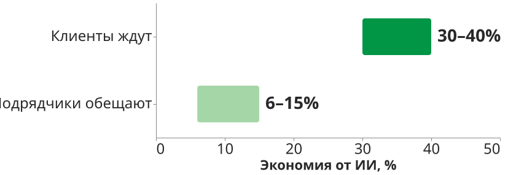
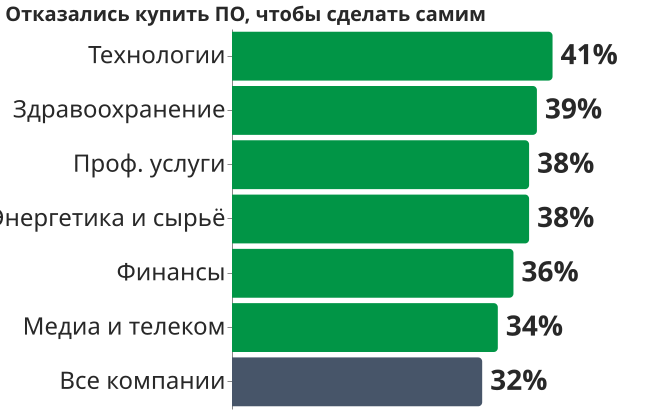
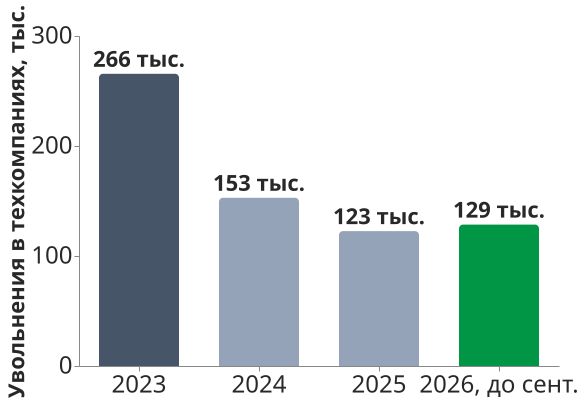
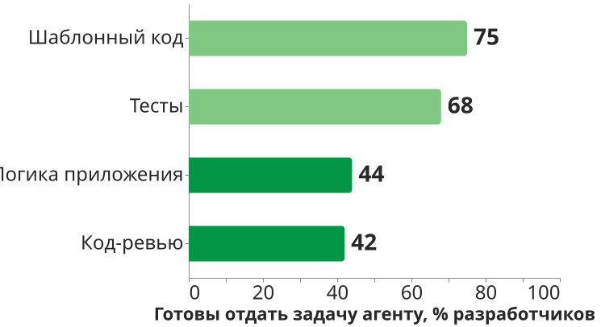
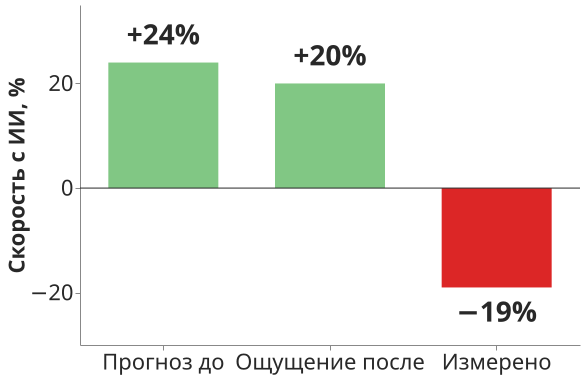
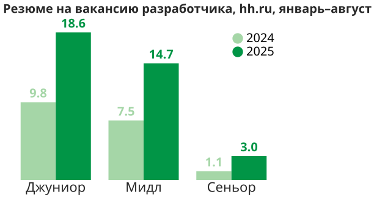

<!-- _class: title -->

# Выжить в эпоху агентов
## …и как в ней преуспеть

Андрей Садовых · Университет Иннополис

<!--
Russian version, 30 minutes, draft 4 (2026-11-20): same structure as ../slides/Surviving-the-Agent-Era.md (English): hook, law, value, then four parts, each a divider, an answer slide and one slide per force or area. Russian data integrated in the main slides. Speaker notes are copied from the English deck.
-->
{{NOTES:Surviving the Agent Era}}

---

<!-- _class: xl b8 -->

# Каких из этих новостей стоит бояться?

<!-- _footer: "CIO.com 2026, on Anthropic's COBOL claim and IBM · Reuters 2026, on India's IT services · Challenger, Gray &amp; Christmas 2026 (via HCAMag) · hh.ru via Kommersant, 11 Sep 2025" -->

- Акции IBM −13% за день: Anthropic заявила, что её ИИ мигрирует COBOL
- Persistent Systems: клиенты хотят ту же работу на 25–30% дешевле
- Challenger: в мае 2026-го 4 из 10 сокращений в США списали на ИИ
- hh.ru: на вакансию джуниора 18,6 резюме, на сеньора — 3

Одни подтверждаются, другие нет. Разберём, <strong>какие и что с этим делать</strong>.

{{NOTES:Which of These Headlines Should Worry You?}}
<!--
Russian version: the fourth headline is hh.ru instead of SignalFire's −65% new graduates. hh.ru analysts to Kommersant, 11 September 2025, programmers and developers, January to August 2025: CVs per vacancy 18.6 junior, 3 senior. Verdict: holds, but the door is not shut (student part, Entry slide).
-->

---

<!-- _class: xl table-xlarge b8 -->

# Сделать стало дёшево, сделать правильно — нет

<strong>Агент</strong> — ИИ, который сам планирует и выполняет многошаговые задачи. Сегодня он помогает почти на каждом шаге, включая проверку.

| Подешевело благодаря агенту | Не подешевело и не передаётся агенту |
|---|---|
| Написать код, тесты, ревью | Выбрать цель |
| Найти уязвимости, предложить правки | Решить, какой риск допустим |
| Собрать работающий прототип | Отвечать за результат |

Ваша зона — <strong>правая колонка</strong>: цель, риск и ответственность остаются за людьми.

{{NOTES:Making Things Got Cheap; Making Them Right Did Not}}

---

<!-- _class: large table-large b8 -->

# Клиент и раньше платил в основном не за код

<!-- _footer: "IDC 2025, How Do Software Developers Spend Their Time? (via InfoWorld, February 2025)" -->

В 2024 году на разработку приложений уходило 16% времени; на проработку требований и тесты — 14%, на безопасность — 13%.

| Клиент платит за | Почему это не дешевеет вместе с кодом |
|---|---|
| Знание бизнеса | Правила — в головах и договорах, а не в модели |
| Архитектуру и выбор технологий | Ошибка стоит лет, а не строк |
| Интеграцию с тем, что уже работает | У каждой системы своя история |
| Безопасность и качество | Их нужно доказать, а не просто пообещать |
| Поддержку и ответственность | Кто-то отвечает, когда всё ломается |

Код дешевеет, а ценность уходит в <strong>архитектуру, интеграцию, безопасность и гарантии</strong>.

{{NOTES:Code Was Never Most of What a Client Pays For}}

---

<!-- _class: lead b1 -->

# Как выжить бизнесу

## Пять сил бьют по продаже кода, но на каждую есть ответ

---

<!-- _class: xl b1 -->

# Продавайте результат, а не код

<!-- _footer: "Porter 2008, The Five Competitive Forces (framework) · CIO.com 2026, on Anthropic's COBOL claim and IBM" -->

Каждая сила режет цены и маржу — <strong>но на каждую есть ответ</strong>.

{{NOTES:A Firm Thrives by Selling the Result, Not the Code}}

---

<!-- _class: xl b1 -->

# Заказчики: результат вместо человеко-часов

<!-- _footer: "BCG 2026, The $200 Billion AI Opportunity in Tech Services · Reuters 2026, on AI and India's IT services sector · TCS and Infosys, FY2022 results" -->

- Persistent Systems: клиенты хотят ту же работу на 25–30% дешевле
- Индийский аутсорс: рост упал с 15–20% в 2022-м до 1–3%
- В ряде направлений TCS привязала цену к результату в 80% контрактов

Хвастаетесь перед клиентом ускорением от ИИ — он слышит: «дайте скидку». <strong>Берите плату за результат</strong>, как начала делать TCS.

{{NOTES:Buyers: Sell Results, Not Hours}}

---

<!-- _class: xl b1 -->

# Поставщики ИИ: держите запасную модель

<!-- _footer: "Menlo Ventures 2026, The State of Enterprise AI · The Guardian and Fortune 2026, on the US order · TechCrunch 2026, on Uber's cap · Anthropic, OpenAI, Google supported-country lists" -->

- На Anthropic и OpenAI — 86% корпоративных расходов на модели, и они же продают инструменты для кода
- Июнь 2026: власти США на <strong>19 дней</strong> отключили новейшую модель Anthropic для всех
- В России, Беларуси, Китае и Иране ведущие модели и так недоступны
- Uber сжёг годовой бюджет на ИИ за 4 месяца; теперь лимит — $1 500 в месяц на инженера и инструмент

Держите запасную модель и <strong>считайте ИИ как электричество</strong>: агент работает весь день, а счётчик крутится.

{{NOTES:Suppliers: Keep a Second Model, Meter the Bill}}
<!--
Russian version: the third bullet replaces "Firms spent 4.7 times last year's AI bill". Three vendors' country lists (Anthropic, OpenAI, Google) leave out Russia, Belarus, China and Iran; lock-in is everyone's problem: Europe buys more than 80% of its digital technology from abroad.
-->

---

<!-- _class: xl b1 -->

# Замена: держитесь за то, что не скопировать

<!-- _footer: "McKinsey 2026, The State of AI in 2026 · Cloudflare 2026, on vinext · Diginomica 2025, on Klarna · Walling 2026, The Only SaaS Moats Left in 2026 (MicroConf, video)" -->

- McKinsey: каждая третья компания хоть раз отказалась от покупки софта
- Cloudflare клонировала крупный веб-фреймворк за неделю и $1 100
- Но есть предел: Klarna, вопреки слухам, не заменила Salesforce своим ИИ

Код копируют за неделю. <strong>Данные, историю и процессы клиента</strong> — нет.

{{NOTES:Substitutes: Hold What a Copy Cannot Take}}

---

<!-- _class: xl b1 -->

# Новые игроки: отвечайте за результат

<!-- _footer: "9to5Mac 2026, on Sensor Tower App Store data · Moffatt v. Air Canada, 2024 BCCRT 149 · CFO Dive 2025, on Deloitte's refund · EU Product Liability Directive 2024/2853" -->

- App Store: новых приложений +84% за год, а скачиваний всего +2%
- Air Canada объявила чат-бота «отдельным юрлицом» и проиграла суд
- Deloitte вернула Австралии деньги за отчёт с выдуманными источниками
- С 9 декабря 2026 года в ЕС софт юридически приравнен к продукции

Когда софт может сделать каждый, платят за <strong>результат, который не надо перепроверять</strong>, — как за расчёт зарплаты и налогов.

{{NOTES:New Entrants: Be the One Who Answers for It}}

---

<!-- _class: lead b2 -->

# Как выжить специалисту

## Что меняется в работе и что с этим делать

---

<!-- _class: large table-large b2 -->

# Агент забрал кодинг, но не экспертизу

| | Что говорят данные | Что делать |
|---|---|---|
| <strong>Сокращения</strong> | Начались до ИИ; ИИ решает, какие места не вернутся | Идите туда, где работы прибавляется |
| <strong>Кодинг</strong> | Перевод тикетов в код агент забирает первым | Ставьте задачу, принимайте работу, отвечайте за неё |
| <strong>Проверка</strong> | Съедает время, которое экономит агент | Измеряйте задачу целиком; стройте конвейер агентов |
| <strong>Экспертиза</strong> | Сила сеньора — видеть, когда агент ошибается | Знайте инженерию и хотя бы одну предметную область |

В небольших командах роли сливаются: растите в сторону <strong>продукта и клиента</strong>, а если руководите — продолжайте нанимать джуниоров.

{{NOTES:The Agent Took the Typing, Not the Judgement}}

---

<!-- _class: xl b2 -->

# Сокращения: ИИ решает, какие места не вернутся

<!-- _footer: "Layoffs.fyi tracker (via Free Press Journal 2026) · Challenger, Gray &amp; Christmas 2026 (via HCAMag) · Bank of Russia, 23 Oct 2026 · Federal Law 425-FZ, 2025" -->

- Самая большая волна — 2023 год, до агентов
- «Из-за ИИ» в США: 4 из 10 сокращений в мае, 3 из 100 в октябре
- Россия: ключевая ставка 14%, взносы ИТ-компаний 7,6% → 15%

Когда сокращать, решает <strong>экономика</strong>; кого — <strong>навыки</strong>; какие должности исчезнут из штатного расписания — <strong>ИИ</strong>.

{{NOTES:Cuts: Before AI, but AI Decides What Stays Cut}}
<!--
Russian version: the third bullet replaces Block and Accenture (keep them for the three readings, said aloud). Bank of Russia key rate 14.00% (23 October 2026); Federal Law 425-FZ: accredited IT firms pay 15% up to the contribution cap from 1 January 2026, instead of 7.6%. The ministry blames shifting demand and a wave of graduates; SuperJob: "the high key rate means R&D projects are postponed". In Russia the economy explains more than AI. Details: research_notes/.../gaps_russia_market.md, section 4.
-->

---

<!-- _class: xl b2 -->

# Кодинг: станьте заказчиком для агента

<!-- _footer: "Yandex 2026, press release of 29 July · The Moscow Times 2026, on Gref, 11 Feb and 13 Nov · US BLS, Occupational Outlook 2025–2035 · JetBrains 2026, raw data; own computation" -->

- Яндекс: больше половины нового кода пишет ИИ; агент ведёт задачу «от тикета до готового кода»
- Сбер: «более 50% кода пишут агенты»
- США до 2035: «программисты» (код по спецификации) −7%, «разработчики» +10%

Первым уходит кодинг, за ним — тесты и ревью. Станьте тем, кто <strong>принимает работу и отвечает за неё</strong>.

{{NOTES:Typing: Goes First, So Specify and Approve}}
<!--
Yandex internal agent GENA "solves programmers' tasks from ticket to finished code"; programme 75/75/75; 73% of developers use AI regularly. Sber: Gref, February 2026: "Last year we cut 20% of staff and 20% of engineers"; in 2026 Sber hired three times more AI staff than in all of 2025.
-->

---

<!-- _class: xl b2 -->

# Проверка: измеряйте задачу целиком

<!-- _footer: "Becker et al. 2025, Measuring the Impact of Early-2025 AI on Experienced Open-Source Developer Productivity (METR) · METR 2026, uplift update" -->

- 2025: 16 сеньоров в знакомых им проектах
- Меньше кодинга, больше промптов, ожидания и ревью
- Авторы допускают, что инструменты 2026 года быстрее

Ощущение скорости даёт кодинг. Измеряйте задачу целиком и <strong>встраивайте проверку в конвейер агентов</strong>.

{{NOTES:Checking: Eats the Gain, So Measure the Whole Task}}

---

<!-- _class: xl table-large b2 -->

# Экспертиза: ловите агента за руку

<!-- _footer: "JetBrains 2026, Developer Ecosystem Survey, raw data; own computation · GitClear 2026, Write-Only Mode · DORA 2025, State of AI-assisted Software Development" -->

| Пользователи агентов | Джуниоры | Сеньоры |
|---|---:|---:|
| Пользуются агентом каждый день | 58% | 69% |
| Считают его код хуже своего | 20% | 28% |
| Всегда проверяют, что он написал | 41% | 46% |

Мусор на входе — мусора на выходе ещё больше: дублей кода +81% с 2023 года.

Знайте <strong>инженерию и хотя бы одну предметную область</strong> — тогда ошибки агента видны.

{{NOTES:Judgement: Know When the Agent Is Wrong}}

---

<!-- _class: lead b3 -->

# Как выжить студенту

## Где дверь ещё открыта и как в неё пройти

---

<!-- _class: xl table-large b3 -->

# Войти рано, целиться точно, растить экспертизу

| | Что говорят данные | Что делать |
|---|---|---|
| <strong>Вход</strong> | Джуниоров берут меньше, но дверь открыта | Выходите к реальному заказчику пораньше: стажировки, проекты |
| <strong>Цель</strong> | Фронтенд и типовые тикеты сжимаются; безопасность и данные растут | Выбирайте работу ближе к решениям, рискам или клиенту |
| <strong>Учёба</strong> | Экспертиза растёт из работы, сделанной своими руками | Сначала напишите сами, потом сравните с агентом |

Агент должен <strong>ускорять учёбу, а не заменять её</strong>.

{{NOTES:Get In Early, Aim Well, Build Judgement}}

---

<!-- _class: xl b3 -->

# Вход: джуниоров берут меньше, но дверь открыта

<!-- _footer: "hh.ru via Kommersant, 11 Sep 2025 · hh.ru statistics dashboard, Oct 2026 · Habr Career, IT hiring report H2 2025 · Cloudflare 2026 · Fortune 2026, on forward deployed engineers" -->

- Habr Career: только 7% ИТ-вакансий — для джуниоров
- Cloudflare принял 750 стажёров и идёт к 1 111
- Вакансий инженеров на стороне заказчика: ×10 за год

Берут тех джуниоров, кто умеет <strong>критически оценивать, объяснять и работать с клиентом</strong>.

{{NOTES:Entry: Fewer Juniors Get In, but the Door Is Open}}
<!--
Russian data (gaps_russia_market.md): chart from hh.ru analysts to Kommersant, 11 September 2025, programmers and developers, January to August: CVs per vacancy 18.6 junior, 14.7 middle, 3 senior; a year earlier 9.8, 7.5, 1.1. 18.6 / 3 = 6.2: a junior has six times the competition of a senior. The grade split exists only in that press statement. All IT, October 2026: 29.8 CVs per vacancy (hh.index; 12 or more is "extremely high competition"). 7% junior, 3% intern: Habr Career, H2 2025, 8,220 vacancies with a stated grade.
Do not use the older "19 per junior, 2 per senior" (the 2 was Zerocoder's number).
The US chart (SignalFire, new graduates −65% against 2019) is in the English deck; say it aloud if useful.
-->

---

<!-- _class: large b3 -->

# Цель: ближе к решениям, рискам или клиенту

<!-- _footer: "US jobs: BLS 2025–35 · tech share since 2022: SignalFire 2026 · Russia: Habr Career via Kommersant 2026 · JetBrains 2026 · Microsoft 2026 · QA Financial 2026 · Demirci et al. 2024 · Fortune 2026" -->

| Рискованная цель | Сильная цель | Данные | Вход для джуниора |
|---|---|---|---|
| Только фронтенд (доля −25%) | Безопасность | США +21%; в России вакансии упали меньше всех | Ревью безопасности кода, эксплуатация |
| Тикет → код (США −7%) | Архитектура | Занимает больше времени, чем код | Дизайн-документы, код-ревью |
| Ручное тестирование (68% отдали бы агенту) | Инженерия качества | JPMorgan: ценность роли выросла | Автоматизация тестов |
| ИТ-поддержка, админы (США −3%, −4%) | Данные и ИИ | США +35%; в России ИИ −27% при рынке −56% | Дата-инжиниринг, аналитика |
| Фриланс: тексты, дизайн (от −19 до −30%) | Инженер на стороне заказчика | Вакансий ×10 | Стажировка у заказчика |

Рост считают по профессии в целом, и почти везде нужен опыт: <strong>начинайте со смежных ролей</strong>.

{{NOTES:Aim: Next to a Decision, a Risk or a Client}}
<!--
Russian lines: Habr Career via Kommersant, 10 July 2026: vacancies on the platform −56% in H1 2026; smallest falls in information security (−40%) and AI (−27%); largest in design, testing and marketing; job seekers +69%. Habr Career is a smaller, IT-only board.
-->

---

<!-- _class: xl b3 -->

# Учёба: сначала сами, потом сравните

<!-- _footer: "CMU News 2026, Navigating the AI Era with a CMU Focus on Critical Thinking · Microsoft 2026, on PRAISE with CMU · Business Insider 2026, on Nadella" -->

- Декан CMU: меньше писать «много кода с нуля» и больше понимать, как код работает
- Лучшие на курсе по программированию с ИИ «не давали ИИ думать за них»
- Microsoft и CMU: наставник-сеньор для каждого джуниора
- Наделла: «генерация кода подешевела, а трудной стала проверка»

Сначала напишите сами, потом сравните с версией агента: так растёт <strong>экспертиза</strong>.

{{NOTES:Learning: Write It First, Then Compare}}
<!--
The quotes on this slide are the speaker's translations of the English originals given in the notes.
-->

---

<!-- _class: lead b4 -->

# Как преуспеть

## Те же силы, но с другой стороны

---

<!-- _class: xl b4 -->

# Давление на компании — шанс для новичков

<!-- _footer: "TechCrunch 2026, on Lovable · TechCrunch 2025, on Base44 · Cloudflare 2026, on vinext · Deloitte Digital 2026" -->

- Lovable: около $400 млн выручки в год при 146 сотрудниках
- Base44: восемь человек, полгода, продан за $80 млн
- Cloudflare за неделю пересобрала крупный веб-фреймворк
- Новые клиенты: 38% крупных компаний в США уже ведут закупки через ИИ-агентов

Барьеры упали и для вас. <strong>Новый игрок — это вы.</strong>

{{NOTES:The Forces That Squeeze Firms Favour Newcomers}}

---

<!-- _class: xl b4 -->

# Миру не хватает решённых задач, а не кода

<!-- _footer: "UN 2026, The Sustainable Development Goals Report · Scientific American 2026, on Tao's Erdős tracker · Google 2026, on flood forecasting" -->

17 целей ООН до 2030 года, прогресс по 139 задачам с данными о динамике:

- ИИ помог решить около 100 открытых проблем в математике
- ИИ-прогнозы наводнений охватывают 2 млрд человек

Посильных задач стало больше, и каждому решению нужны люди: <strong>собрать, проверить, запустить</strong>.

{{NOTES:The World Is Short of Solved Problems, Not Code}}

---

<!-- _class: xl b4 -->

# Каждое «да» — то, чего агент за вас не сделает

1. Могу ли я хотя бы в одной области заметить, что агент ошибся?
2. Знаю ли я задачу клиента лучше, чем агент?
3. Готов ли я подписаться под этой работой?
4. Понимаю ли я, что сделал агент, а не только пользуюсь им?

Каждое «нет» — то, над чем стоит поработать <strong>в этом году</strong>. Теперь — ваши вопросы и ваши ответы.

{{NOTES:Each Yes Is Something an Agent Cannot Do for You}}

---

<!-- _class: xl b8 -->

# Спасибо тем, кто спорил с этим докладом

- Даниле — его заметки на полях перестроили бизнес-часть
- Дипломникам D26 и выпускникам Иннополиса
- Коллеге-профессору
- Основателю ИИ-стартапа
- Директору компании стратегического консалтинга
- Коллегам из индустрии — за просьбу об одной ясной мысли

Их вопросы сделали доклад точнее. <strong>Теперь ваша очередь.</strong>

---

<!-- _class: closing -->

# Направьте навыки на задачу, которая того стоит

Проверяйте работу агента · знайте свою область · будьте ближе к клиенту · продавайте результат

Энергетика · раннее оповещение о бедствиях · вода · здравоохранение · продовольствие

Андрей Садовых · Университет Иннополис

{{NOTES:Point Your Skills at a Problem Worth Solving}}

---

<!-- _class: lead b8 -->

# Приложение

## Откуда цифры

{{REFERENCES}}
